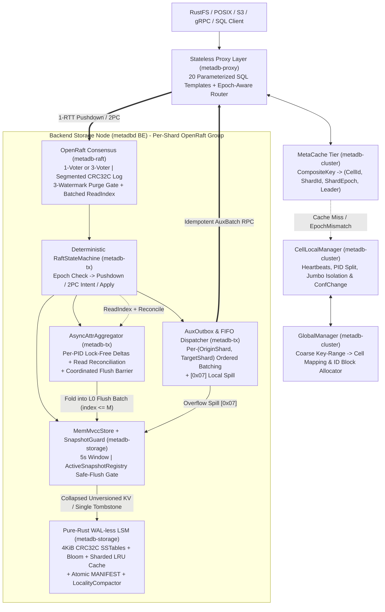

# MetaDB Architecture Specification

* **Project**: `rustfs/MetaDB`
* **Language & Stack**: 100% Pure Rust (`tokio` + `tonic`/`prost` gRPC + `openraft` Multi-Raft + Custom WAL-less LSM Storage; zero C/C++ FFI)
* **Specification Status**: Phase 0 Approved Architecture & Subsystem Suite (see [Section 12](#12-implementation-status-matrix-paper-vs-repository) for current prototype vs. Phase 1–6 implementation status)
* **Design Methodology**: [Google Elephant-Goldfish Model (EGM)](https://github.com/google/elephant-goldfish-model) for Spec-Driven Development (SDD)
* **Primary Theoretical Reference**: This architecture is directly inspired by and adapted from Baidu's trillion-scale production metadata database paper:
  > **Zebin Ren ([@ZebinRen](https://github.com/ZebinRen)), Biao Cao, Kang Chen ([@kangchenPKU](https://github.com/kangchenPKU)), Zhihui Yin, Qiushi Chen, Jielong Jian, Jiwei Xiong, Xinxing Wang, Yan Xing, Liguo Duan, Ran Zheng, Xianjun Meng, and Zhenyu Hou.**
  > *"MetaDB: Putting File-System Structure Back into Distributed Databases"*, arXiv:2610.32247v1 (Vrije Universiteit Amsterdam, Baidu & Peking University, 2026). [https://arxiv.org/html/2610.32247v1](https://arxiv.org/html/2610.32247v1)

---

## 1. Executive Summary & Foundational Attribution

Modern exabyte-scale storage systems—including flat object storage (S3/BOS), hierarchical object namespaces (HDFS-compatible Mantle), and POSIX distributed file systems (CFS)—increasingly delegate metadata management to distributed transactional databases. However, Baidu's five-year production experience reported in `arXiv:2610.32247v1` (operating clusters across **1,000+ metadata machines**, **tens of trillions of metadata records**, and **exabytes of storage**) demonstrates a fundamental architectural lesson: **treating a general-purpose distributed database (such as TiDB or CockroachDB) as a "black box" for file-system metadata leaves 2.2x–4.1x throughput untapped and wastes ~50% of cluster hardware.**

**MetaDB** (`rustfs/MetaDB`) is a 100% pure-Rust, file-system structure-aware, semantic-aware, and lifecycle-aware transactional metadata database engine built for [RustFS](https://github.com/rustfs). It is engineered across an 8-crate workspace to support **seamless online evolution from an embedded or standalone single-node deployment (`1-Voter` OpenRaft) to a multi-cell distributed cluster (`3-Voter` Multi-Raft) designed to scale from single-host workloads to 100 billion – 10+ trillion metadata records.**

> **Distinguishing Reference Benchmarks from Repository Status**:
> Production scale figures cited from `arXiv:2610.32247v1` (e.g., Baidu's 575-node BOS2 cluster managing 1.848 trillion records) are Baidu production results, not results of this repository. `rustfs/MetaDB` is an independent clean-room Rust implementation. It has not passed first-launch acceptance, and merging pull requests #18–#25 does not pass that gate. Status wording is in [Section 12](#12-implementation-status-matrix-paper-vs-repository). Operator behavior is in [`docs/en`](./docs/en/README.md).

---

## 2. Problem Statement: Three Architectural Mismatches

Following the empirical findings of the Baidu MetaDB paper (`arXiv:2610.32247v1`, §2.3), general-purpose distributed databases suffer from three structural mismatches when serving file-system and object-storage metadata:

### 2.1 Data Model Mismatch (Flat Sharding vs. Tree Topology)
* **Observation**: In production file-system workloads (`arXiv:2610.32247v1`, Table 2), **>96%–99% of directory-tree-modifying operations** (`create`, `mkdir`, `unlink`, `rmdir`, `listdir`) are localized single-directory operations touching a child entry and its parent directory's attributes. Cross-directory `rename` accounts for `<3%`.
* **Bottleneck**: General-purpose databases partition tables by arbitrary byte size thresholds or flat hash boundaries. This fractures entries belonging to the same parent directory (`PID`) across multiple shards, escalating localized single-directory operations into multi-shard Two-Phase Commit (2PC) transactions (`100%` multi-shard transaction ratio when secondary/quota indexes are updated synchronously) and requiring multiple network round-trips (RTTs) between stateless SQL proxies and storage nodes.

### 2.2 Transaction Model Mismatch (Rigid ACID vs. Differentiated Semantics)
* **Observation**: Modern AI/ML training pipelines (e.g., distributed checkpoint bursts) concurrently create tens of thousands of files inside the same directory.
* **Bottleneck 1 (Parent Attribute Contention)**: Enforcing synchronous row locks on the shared parent-directory record to update `num_children`, `size_bytes`, and `modify_time` causes throughput to collapse by **10x** (from `~60K QPS` to `~6K QPS` in Baidu's Generation-2 database, and a `36.2x` throughput gap vs. TiDB in single-directory benchmarks).
* **Bottleneck 2 (Over-Strict Auxiliary Atomicity)**: Updating per-user quotas (`QuotaTable`) and reverse data-plane indexes (`SecondaryIndexTable`: `FID -> (PID, name)`) inside the primary ACID transaction forces cross-shard 2PC on every write, even though quota accounting and garbage-collection reverse indexes safely tolerate milliseconds of asynchronous propagation delay provided exact-once idempotency is preserved.

### 2.3 Storage Implementation Mismatch (Long-Lived MVCC vs. Transient Metadata Lifecycle)
* **Observation**: Metadata transactions are overwhelmingly short-lived (`<10ms`, hard-bounded at `5s`), whereas object storage buckets routinely undergo massive consecutive range deletions driven by Time-To-Live (TTL) expirations on time-prefixed keys.
* **Bottleneck**: Traditional LSM-tree + MVCC engines persist both logical MVCC tombstones and physical LSM-tree tombstones to disk ("double-tombstone penalty") to serve hypothetical long-running analytical queries. Passive level-saturation compaction fails to purge localized deletion ranges promptly, causing foreground `listdir` scans (1,000 items) to traverse millions of dead tombstones and spiking latency from `<100ms` to **~6 seconds** (`arXiv:2610.32247v1`, §2.3.3 & §7.4).

---

## 3. Goals & Non-Goals

### 3.1 Goals
1. **Topology-Aligned Single-Shard Execution**: Keep `>96%` of directory modifications strictly within a single shard via `group_key = PID` colocation and execute single-directory Read-Modify-Write (RMW) sequences in a single shard-leader hop (`1 RTT`).
2. **Conflict-Free High-Concurrency Directory Writes**: Eliminate lock contention on hotspot parent directory attributes via lock-free/per-PID in-memory delta aggregation paired with race-free **Read-Path Reconciliation** and a **Coordinated Flush Barrier**.
3. **Zero Double-Tombstone Pure-Rust LSM Storage**: Retain multi-version states strictly in memory (`MemMvccStore` with `SnapshotGuard` registration) for the `5s` transaction window—flushing only collapsed unversioned keys or single physical LSM tombstones (`~60%` KV write reduction)—paired with bottommost-safe **Locality-Aware Compaction**.
4. **Seamless Single-Node to Multi-Cell Evolution**: Run the exact same `StorageBackend` and `openraft` state machine from a single-binary `1-Voter` node to a `3-Voter` Multi-Raft cluster orchestrated by `GlobalManager`, `CellLocalManager`, `MetaCache`, and decentralized `HybridLogicalClock` (`HLC`).
5. **Lightweight 20-Template SQL & Typed gRPC Interfaces**: Compile the 20 canonical metadata SQL patterns directly into typed storage plans alongside high-throughput `tonic` gRPC services and an embedded Rust SDK.

### 3.2 Non-Goals
1. **General-Purpose OLAP / Long-Running Analytical Queries (`>5s`)**: Snapshots held longer than `mvcc_retention_ms` (`5,000ms`) return `MetaDbError::TransactionTimeout`; namespace scans use cursor-paginated `listdir(pid, after_name, limit)`.
2. **Arbitrary Multi-Table SQL Joins or Subqueries**: Only the canonical metadata tables (`MetaTable`, `QuotaTable`, `SecondaryIndexTable`) and fixed metadata SQL templates are supported.
3. **Data-Plane Object Payload Storage**: Raw data blocks/chunks live in the RustFS object/file data plane; MetaDB stores namespace hierarchy, attributes, quotas, and `FID -> (PID, name)` reverse mappings.
4. **C/C++ Storage Dependencies**: External C/C++ engines (e.g., `librocksdb-sys`) are explicitly excluded in favor of a verifiable 100% Rust storage stack.

---

## 4. Binary Data Model & Keyspace Layout (`metadb-core`)

Checksums use crc-fast CRC-32/ISCSI. Persisted and Raft payloads use wincode with the existing bincode 1.x byte grammar and a Serde bridge for OpenRaft types. The [codec dependency analysis](docs/designs/codec_dependencies.md) records compatibility constraints and validation.

Every shard hosts a single sorted key-value keyspace partitioned into seven disjoint 1-byte prefixes (`0x01`–`0x07`) encoded in big-endian lexicographical byte order so integer numeric order matches `memcmp` byte order:

| Prefix | Table / Keyspace | Binary Key Layout | Binary Value Summary | Purpose |
| :--- | :--- | :--- | :--- | :--- |
| `0x01` | `MetaTable` | `[0x01][pid: u64 BE][name: UTF-8]` | `InodeAttr` (`88B` versioned framing + CRC32C: `inode_id`, `parent_pid`, `entry_type`, `uid`, `mode`, `link_count`, `num_children`, `size_bytes`, `create_time`, `modify_time`, `fid`, `applied_raft_index`) | Primary namespace & colocated `(PID, "_attr_")` authoritative directory attributes (`group_key = PID`). |
| `0x02` | `QuotaTable` | `[0x02][uid: u64 BE]` | `QuotaRecord` (`used_bytes`, `used_inodes`, `quota_limit_bytes`, `last_applied_hlc`, `applied_by_shard: BTreeMap<ShardId, (u64, u16)>`) | Per-user storage & inode accounting with contiguous `(origin_raft_index, task_ordinal)` exact-once watermarks. |
| `0x03` | `SecondaryIndexTable` | `[0x03][fid: u64 BE]` | `SecondaryIndexRecord` (`pid`, `name`, `create_time`, `last_ver: (Hlc, ShardId, u64, u16)`, `tombstone_ver`, `is_deleted`) | Data-plane `FID -> (PID, name)` reverse index with total-order tie-breaking. |
| `0x04` | `DirShardDelta` | `[0x04][pid: u64 BE]` | `DirShardDeltaRecord` (`inode_id`, `parent_pid`, `uid`, `mode`, `create_time`, `delta_children`, `delta_bytes`, `modify_time`, `applied_raft_index`, `deleting_fence`) | Shard-local partial directory stats & existence lease for `DualModeFineGrained` sub-shards. |
| `0x05` | `WriteIntent` | `[0x05][target_user_key]` | `WriteIntentRecord` (`txn_id: u128`, `primary_key`, `start_hlc`, `expire_hlc`, `rename_fence_token`, `op: Put \| Delete \| DeletingDir \| DirExistsFence`) | Durable Raft-replicated 2PC participant locks surviving node restarts, splits, and leader failovers. |
| `0x06` | `TxnRecord` | `[0x06][txn_id: u128 BE]` | `TxnStatusRecord` (`state: Pending \| Committed{commit_hlc} \| Aborted`, `pending_ack_keys`, `primary_key`, `expire_hlc`, `rename_fence_token`) | Primary-Anchored 2PC commit/abort source of truth, retained until all participant shards durably ACK. |
| `0x07` | `SpilledAuxOutbox` | `[0x07][origin_raft_index: u64 BE][task_ordinal: u16 BE]` | `AuxUpdateTask` (`origin_shard_id`, `origin_raft_index`, `task_ordinal`, `hlc`, `QuotaDelta \| IndexUpsert \| IndexDelete`) | Local persistent overflow queue cleaned via `RaftCmd::AckAuxTasks` so remote sink partitions never block Raft log purge. |

### Why `(PID, "_attr_")` Colocation Matters
In `MetaTable` (`0x01`), user entry names equal to `"_attr_"`, empty strings, or strings containing `'\0'` are rejected at ingress (`MetaDbError::ReservedEntryName`). Because `(PID, "_attr_")` shares the exact 9-byte prefix `[0x01][pid: u64 BE]` with all direct children `(PID, child_name)`, splitting shards strictly on `group_key = PID` boundaries guarantees that a directory's attribute record and all of its children reside on the **same shard** in `DirectoryColocated` mode.

---

## 5. System Architecture & The Three Core Pillars



### Pillar ①: Tree-Topology-Induced Sharding & Execution (`metadb-cluster` & `metadb-tx`)
1. **Epoch-Fenced `group_key = PID` Sharding**:
   * Each shard owns a `CompositeKeyRange` `[start_key, end_key)` versioned by `ShardEpoch { conf_ver, version }`. Every RPC carries `expected_epoch`; stale routes are fenced both pre-proposal and inside `RaftStateMachine::apply` (`MetaDbError::EpochMismatch`).
   * When shard size crosses `shard_split_threshold_bytes` (`4 GiB` production default), `PolicyShardSplitter` scans SSTable block-index midpoints (without reading values) to select a clean `PID` boundary `split_pid`, executing a deterministic `RaftCmd::ExecuteSplit` across replicas.
2. **Two-Level Jumbo Shard Defense (`JumboIsolated` + `DualModeFineGrained`)**:
   * *Level 1 — Dedicated Node Isolation*: When a single directory dominates `>80%` of an oversized shard (`UnsplittableJumboShard`), `CellLocalManager` transitions the shard to `JumboIsolated`, migrating co-hosted peer shards off that BE node so the jumbo directory gets dedicated CPU and NVMe bandwidth.
   * *Level 2 — Dual-Mode `(PID, name)` Split Fallback*: If a single directory outgrows a dedicated node, policy or `metadb-ctl` switches that `PID` to `DualModeFineGrained`, splitting along `(PID, split_name)` boundaries. Non-anchor sub-shards maintain shard-local `DirShardDelta` (`[0x04][pid: 8B BE]`) records initialized at split time:
     * `create_file` and `unlink` remain **lock-free `1-RTT` single-shard operations** on `route_composite(pid, name)`.
     * `dirstat(pid)` performs a `1-hop` parallel scatter-gather across the `K` sub-shards covering `[pid, pid+1)`, summing reconciled `num_children` and `size_bytes` and taking `max(modify_time)`.
     * `listdir(pid, after_name, limit)` streams cursor-paginated entries across sub-shards in lexicographical order.
3. **Single-Shard Pushdown vs. Crash-Recoverable Primary-Anchored 2PC**:
   * `create_file` and `unlink` always touch a single `(PID, name)` key prefix and execute in `1 RTT` via `PushdownExecutor`.
   * `mkdir` and `rmdir` execute in `1 RTT` when `Shard(parent_pid) == Shard(dir_id)` (promoted via shard-affinity directory ID allocation), and automatically escalate to **Primary-Anchored 2PC** when `Shard(parent_pid) != Shard(dir_id)` or when `dir_id` is in `DualModeFineGrained` mode.
   * Cross-directory `rename(src_pid, src_name, dst_pid, dst_name, overwrite)` uses `PushdownExecutor` (`1 RTT`) when `Shard(src_pid, src_name) == Shard(dst_pid, dst_name)` and Primary-Anchored 2PC (`[0x05] WriteIntent` + `[0x06] TxnRecord` with `ttl_ms = 3,000ms` and `TxnRecoveryWorker` roll-forward/abort) across distinct shards.

### Pillar ②: Semantic-Aware Off-Critical-Path Processing (`metadb-tx`)
1. **Conflict-Free Asynchronous Attribute Aggregation & Coordinated Flush Barrier**:
   * Foreground child mutations never lock or rewrite `(PID, "_attr_")`. When `RaftStateMachine::apply` commits a child write at `raft_index = N` with `entry.hlc`, it appends an in-memory `AttrDelta { pid, delta_children, delta_bytes, hlc: entry.hlc, raft_index: N }`.
   * **Race-Free Read-Path Reconciliation**: `dirstat(pid)` (after `ReadIndex` fence) reads `(PID, "_attr_")` under a `SnapshotGuard` and folds strictly those deltas with ` in_memory_delta.raft_index > persisted_attr.applied_index && delta.hlc <= snapshot.read_hlc`.
   * **Coordinated Flush Barrier**: When `MemMvccStore` seals an `ImmMemTable` up to `raft_index = M` for L0 SSTable flush, `AsyncAttrAggregator` folds all pending deltas with `raft_index <= M` directly into the L0 SSTable batch (`applied_index = M`, timestamp = `max_delta_hlc`—100% deterministic across all Raft replicas!) and prunes deltas `<= M` from memory **only after** the new LSM `Version` is atomically installed and `MANIFEST` is `fdatasync`'d.
   * **Authoritative `rmdir`**: Never trusts asynchronous `num_children`; single-shard `rmdir` scans `[target_dir_id, target_dir_id+1)` inside deterministic Raft `apply`, and cross-shard 2PC `rmdir` places `WriteIntent::DeletingDir` on `(target_dir_id, "_attr_")` during Prepare after verifying zero live children so concurrent `create_file` calls cannot slip in before Commit.
2. **Decoupled Exact-Once `AuxOutbox` (`QuotaTable` & `SecondaryIndexTable`)**:
   * `apply` appends `AuxUpdateTask { origin_shard_id, origin_raft_index, hlc, payload }` into the shard's `AuxOutbox`.
   * `AuxDispatcher` drains batches on the shard leader in **strictly ascending `origin_raft_index` FIFO order per `(origin_shard_id, target_shard_id)`**, then proposes a lightweight `RaftCmd::AckAuxWatermark` to advance `replicated_aux_acked_index` across followers.
   * If remote shards are unreachable beyond `max_in_memory_outbox_tasks`, un-acked tasks up to `M` spill into `[0x07] SpilledAuxOutbox` inside the local L0 SSTable flush, immediately advancing `aux_outbox_durable_index` so Raft logs never grow unbounded.
   * `QuotaTable` deduplicates additive deltas via `applied_index_by_shard[origin_shard_id]` (globally unique `ShardId`s are never reused across splits), and `SecondaryIndexTable` enforces monotonic `(last_applied_hlc, tombstone_hlc)` ordering.

### Pillar ③: Lifecycle-Aware Pure-Rust Storage Engine (`metadb-storage` & `metadb-raft`)
1. **WAL-less LSM + 3-Watermark OpenRaft Log**:
   * `LsmStorageBackend` disables local KV WAL files completely; OpenRaft's segmented CRC32C log (`segment_<first_index>.raftlog` + durable `last_committed` in `HARD_STATE`) is the sole sequential write-ahead durability log.
   * OpenRaft log truncation (`purge`) is strictly bounded by three subsystem watermarks:
     $$\text{safe\_purge\_index} = \min\big(\text{state\_flushed\_index},\ \text{aux\_outbox\_durable\_index},\ \text{last\_snapshot\_index}\big)$$
     where `state_flushed_index` advances atomically only when both `MemMvccStore` and folded `AsyncAttrAggregator` updates up to `M` are durable in L0 SSTables + `MANIFEST`, and `aux_outbox_durable_index` advances strictly along contiguous `origin_raft_index` coverage frontiers.
2. **`SnapshotGuard` & `ReadCut` In-Memory MVCC (`MemMvccStore`)**:
   * Readers register an RAII `SnapshotGuard` pinning an immutable `ReadCut { max_raft_index, max_hlc }` + `Arc<Version>` + `Vec<Arc<ImmMemTable>>` with bounded per-page step leases (`<= 5,000ms` timeout) in `ActiveSnapshotRegistry`.
   * Sealed `ImmMemTable`s wait until `min_active_snapshot_hlc >= imm.max_hlc`, then write **only** the collapsed latest value (`Put`) or a single unversioned physical LSM `Delete` tombstone to a generation-ordered (`flush_generation`) L0 SSTable—mathematically preventing phantom/future-read anomalies while eliminating persisted MVCC tombstones (`~60%` fewer KV writes).
3. **Bottommost-Safe Locality-Aware Compaction (`LocalityCompactor`)**:
   * Tracks physical tombstone counts and tombstone-to-live ratios per 9-byte `[table_prefix][group_key: 8B]` spatial bucket.
   * When a bucket crosses `tombstone_density_threshold` (e.g., consecutive TTL expirations), `LocalityCompactor` triggers a targeted range compaction over `[bucket, bucket + 1)` spanning all overlapping SSTables down to the bottommost level for that range—legally dropping physical tombstones without rewriting cold neighboring directories. A flat `listdir` P99 under `<4ms` is a design target in `arXiv:2610.32247v1`, not a measured result of this repository. Latency numbers from the earlier single-node comparison on commit `f325f6a` are not results for this tree and are not repeated here.

---

## 6. Capacity Model (`100M` to `10T+` Records)

This section is not a verification of `rustfs/MetaDB`. Trillion-scale figures in §6.1 are Baidu production data from `arXiv:2610.32247v1`, not results of this repository. §6.2 is an arithmetic model from the assumptions stated there. It is not a load measurement, and it is not a first-launch or trillion-scale milestone. Merging pull requests #18–#25 does not supply either result.

### 6.1 Baidu Production Figures (`arXiv:2610.32247v1`, Table 1)
The following figures are Baidu's published production results. They do not measure this repository:
* **BOS2 Cluster**: **575 BE nodes**, **1.848 trillion (`1.848 × 10^12`) metadata records**, **909 PB** backing storage, sustaining **2.063M read QPS** and **747K write QPS**.
* **BOS1 & BOS3 Clusters**: **414** and **406 BE nodes** managing **1.343T** and **1.356T** records respectively.
* **Hardware Efficiency**: For that Baidu deployment, the paper reports cutting metadata server count by `~50%` while delivering `2.2x–4.1x` higher throughput than general-purpose distributed SQL baselines.

### 6.2 Quantitative Capacity Model for `rustfs/MetaDB`

The rows below multiply the assumptions in this paragraph. They were not measured on this repository.

Assuming `~180 B` average prefix-compressed record footprint across primary + auxiliary tables, `4 GiB` target shard size, `10 bits/key` Bloom filter (`~1.25 B/key`), and sparse 4 KiB block index (`~12 B / 4 KiB` block $\approx 0.54\text{ B/key}$):

| Scale Tier | Total Records | Logical KV Footprint | 3-Replica NVMe Footprint | Shards (@ 4 GiB) | Per-Node RAM (Bloom + Index + MVCC) | Target Cluster Topology |
| :--- | :--- | :--- | :--- | :--- | :--- | :--- |
| **Stage 1: Single-Node** | `100M` (`10^8`) | `~18 GB` | `~18 GB` (`1-Voter`) | `5 – 16` | `< 2 GiB` (`~180 MB` index/Bloom) | **1 `metadbd` Node** (`all-in-one`) |
| **100 Billion (`10^11`)** | `100B` | `~18 TB` | `~54 TB` (`3-Voter`) | `~4,500` | `~32 GiB / node` across 20 BE nodes | **1 Cell** (`20 BE nodes`) + `MetaCache` |
| **1 Trillion (`10^12`)** | `1T` | `~180 TB` | `~540 TB` (`3-Voter`) | `~45,000` | `~48 GiB / node` across 160 BE nodes | `GlobalManager` + **4 Cells** (`160 BE nodes`) |
| **10 Trillion (`10^13`)** | `10T` | `~1.8 PB` | `~5.4 PB` (`3-Voter`) | `~450,000` | `~64 GiB / node` across 1,000 BE nodes | `GlobalManager` + **20 Cells** (`1,000 BE nodes`) |

### 6.3 Design Argument: No Central Bottleneck in the `10T+` Model
The points below are design arguments for the capacity model. They are not measurements of this repository at `10T+`.
1. **Data Plane (`<4%` Multi-Shard Txns)**: `group_key = PID` colocation + async `AuxOutbox` eliminate cross-shard 2PC for `>96%` of writes, yielding linear QPS scaling with BE node count.
2. **Control Plane (Two-Tier `GlobalManager` + `CellLocalManager`)**: Partitioning `450,000+` shards into independent **Cells** (`20K–30K` shards per `CellLocalManager`) bounds per-manager Raft heartbeat load while `GlobalManager` tracks `<1,000` coarse Cell range entries.
3. **Timestamps (Decentralized `HLC` with Drift Guard)**: Eliminates central Timestamp Oracle (TSO) network round-trips and single points of write failure; bounded drift checks (`500ms`) protect causal ordering.
4. **Routing (`MetaCache` + Epoch Pull-on-Mismatch)**: Proxies route in `1` hop with `>99.9%` cache hit rate and self-heal on `EpochMismatch` without manager thundering herds.

---

## 7. Seamless Three-Stage Evolution: Single-Node to Distributed Cluster

The stages below are the design path. [Section 12](#12-implementation-status-matrix-paper-vs-repository) records what this tree has exercised. `metadbd` serves `all-in-one` only, and `RegisterCell` does not store a second Cell. The design keeps the same `LsmStorageBackend` and `openraft` state machine across stages:

1. **Stage 1 — Single-Node All-in-One (`1-Voter` OpenRaft)**:
   * A single `metadbd --role all-in-one` binary (or embedded `MetaDbEngine` library) runs `GlobalManager`, `CellLocalManager`, `MetaCache`, `Proxy`, and a `1-Voter` OpenRaft group in-process (`0` network hops for `ReadIndex` and consensus commit; sequential disk `fdatasync` only on Raft log segments).
2. **Stage 2 — Dynamic Multi-Shard Split on Single Host**:
   * Starts with root shard `[0, u64::MAX)` and automatically executes `RaftCmd::ExecuteSplit` along `group_key = PID` boundaries as directories grow, scaling concurrency across multiple local Multi-Raft groups.
3. **Stage 3 — Zero-Downtime Scale-Out to Multi-Node & Multi-Cell (`1 -> 3 -> N` Nodes)**:
   * **Replica Promotion (`1 -> 3` Voters)**: Additional `metadbd --role be` nodes join; `ConfChangeOrchestrator` calls `AddLearner`, streams LSM SSTable snapshots + retained Raft log segments, verifies lag `< threshold`, and promotes learners to `Voter`s via OpenRaft joint consensus with zero write interruption.
   * **Shard Balancing & Jumbo Isolation (`3 -> N` Nodes)**: `CellLocalManager` transfers leadership and replicas across nodes and isolates `JumboIsolated` shards onto dedicated hosts.
   * **Multi-Cell Federation (`N -> 1,000+` Nodes)**: `GlobalManager` registers new `CellLocalManager` clusters and assigns contiguous key-range partitions as capacity grows.

---

## 8. Workspace Crate Architecture (8 Pure-Rust Crates)

```text
rustfs/MetaDB
├── Architecture.md                              # Master technical specification (English)
├── README.md                                    # Project overview, status, and links
├── Cargo.toml                                   # 8-crate Cargo workspace manifest
├── _agents/skills/metadb_elephant/SKILL.md      # EGM Elephant project context skill
├── docs/
│   ├── README.md                                # Multilingual documentation hub
│   ├── DEVELOPMENT_PLAN.md                      # Phased Rust engineering plan (Phases 1–6)
│   ├── designs/                                 # EGM Formal Specifications & Review Reports
│   │   ├── SITEMAP.md
│   │   ├── concepts_brief.md
│   │   ├── metadb_architecture.md
│   │   ├── storage_lsm_mvcc.md
│   │   ├── consensus_and_transactions.md
│   │   ├── sharding_and_control_plane.md
│   │   └── review_report.md
│   └── guides/{en,ja,fr,zh,de}/                 # User & Operator Guides in 5 Languages
└── crates/
    ├── metadb-core/                             # HLC (+ drift guard), 0x01..0x07 binary codecs,
    │                                            # CompositeKeyRange, ShardEpoch, CRC32C, Errors
    ├── metadb-proto/                            # Protobuf v1 contracts & tonic/prost gRPC stubs
    ├── metadb-storage/                          # StorageBackend trait, pure-Rust WAL-less SSTable LSM,
    │                                            # Manifest, BlockCache, Bloom, SnapshotGuard MVCC,
    │                                            # LocalityCompactor
    ├── metadb-raft/                             # OpenRaft Multi-Raft, segmented CRC32C log store,
    │                                            # 3-watermark purge gate, ReadIndex batcher, ConfChange
    ├── metadb-tx/                               # Deterministic RaftStateMachine, 1-RTT Pushdown,
    │                                            # AsyncAttrAggregator, FIFO AuxOutbox + Spill,
    │                                            # Primary-Anchored 2PC & TxnRecoveryWorker
    ├── metadb-cluster/                          # PID & DualMode splitter, Epoch fencing, Jumbo isolation,
    │                                            # CellLocalManager, GlobalManager, MetaCache, IdAllocator
    ├── metadb-proxy/                            # 20 parameterized SQL templates + Epoch-aware router
    └── metadb-server/                           # Embedded MetaDbEngine SDK + metadbd + metadb-ctl
```

---

## 9. Alternatives Considered (EGM Mandatory Section)

1. **Unmodified General-Purpose Distributed SQL (TiDB / CockroachDB)**:
   * *Rejected*: Incurs `100%` multi-shard transactions when secondary/quota indexes are maintained synchronously, suffers `10x–36.2x` throughput collapse under single-directory concurrent writes, and exhibits `2.5s–6s` `listdir` latency spikes under bulk TTL deletions (`arXiv:2610.32247v1`, §7 & Appendix A).
2. **RocksDB (`librocksdb-sys` C++ FFI) vs. Custom Pure-Rust WAL-less LSM**:
   * *Rejected*: C++ FFI complicates cross-compilation, memory-budget unification with Rust async runtimes, and custom `SnapshotGuard`-gated unversioned flush pruning + 9-byte prefix-bucket tombstone density hooks. Our pure-Rust `StorageBackend` implements the exact SSTable/Bloom/BlockCache/Manifest primitives needed by MetaDB while remaining pluggable via trait abstraction.
3. **Custom Bespoke Consensus vs. `openraft` Multi-Raft**:
   * *Rejected*: Hand-rolling Raft election, joint-consensus `ConfChange`, and `ReadIndex` is error-prone (cf. Baidu's 6-month custom replication postmortem in `arXiv:2610.32247v1`, §8). `openraft` provides battle-tested pure-Rust joint consensus and linearizable `ReadIndex` over custom `RaftLogStorage` and `tonic` transport.
4. **Bypassing Raft in Single-Node Mode via Separate KV WAL**:
   * *Rejected*: Dual durability code paths break crash-recovery symmetry for `MemMvccStore`, `AsyncAttrAggregator`, and `AuxOutbox` during online `1-Voter -> 3-Voter` promotion. A `1-Voter` OpenRaft log performs a single sequential disk append identical in I/O cost to a WAL while keeping 100% state-machine parity.
5. **Time-Bounded Eager LSM Compaction (Lethe / Acheron)**:
   * *Rejected*: Rigid age-based compaction rewrites cold SSTable levels with high write amplification; `LocalityCompactor` compacts strictly those narrow prefix buckets experiencing high tombstone density.

---

## 10. Risks, Failure Modes & Mitigations (EGM Mandatory Section)

| Failure Mode / Risk | Impact if Unmitigated | Architectural Mitigation |
| :--- | :--- | :--- |
| **Extreme Single-Directory Skew (Jumbo Shard)** | Single `PID` with `>500M` files saturates one shared node or exceeds single-host disk. | 1. `JumboIsolated` dedicated-node scheduling evicts peer shards.<br>2. `DualModeFineGrained` `(PID, name)` splitting with shard-local `DirShardDelta` (`[0x04]`) keeps `create`/`unlink` `1-RTT` lock-free and `dirstat` `1-hop` scatter-gather. |
| **Future-Read Anomaly on Unversioned SSTables** | Reader at `T_1` falls through `MemMvccStore` into an L0 SSTable overwritten at `T_2 > T_1`. | `ActiveSnapshotRegistry` pins `ImmMemTable` flush until `min_active_snapshot_hlc >= imm.max_hlc` (capped at `5s` timeout), proving $read\_hlc \ge H_{\text{disk}}$ for every valid reader. |
| **Shadowed-Key Resurrection in Range Compaction** | Dropping a physical tombstone at `L1` resurrects an older value in `L2`. | `LocalityCompactor` includes all overlapping SSTables down to the bottommost level for `[start_key, end_key)` and drops tombstones strictly when no deeper overlapping SSTable exists. |
| **Crash Between `AttrDelta` Fold and SSTable Flush** | Truncating Raft log before folded `(PID, "_attr_")` hits disk loses counts. | **Coordinated Flush Barrier**: folded `_attr_` updates up to `M` flush inside the same L0 SSTable + `MANIFEST` `fdatasync` before `attr_flushed_index` advances to `M`. |
| **Coordinator Crash Mid-2PC `Rename` / `Rmdir`** | Participant keys stay locked or diverge across shards. | Primary-Anchored `[0x06] TxnRecord` + `[0x05] WriteIntent` with `3s` TTL; readers/writers resolve encountered intents on-demand and `TxnRecoveryWorker` rolls forward/aborts orphaned txns. |
| **Remote Auxiliary Shard Partition Blocking Log Purge** | Un-acked in-memory `AuxOutbox` prevents Raft log truncation. | Overdue `AuxOutbox` tasks spill to local `[0x07] SpilledAuxOutbox` during L0 flush, advancing `aux_outbox_durable_index` immediately while preserving strict FIFO exact-once replay. |
| **Wall-Clock Skew Across Distributed Nodes** | Skewed node clock pushes HLC far into the future, prematurely expiring `5s` MVCC windows. | `HybridLogicalClock::update_checked` enforces `max_clock_drift_ms` (`500ms`), rejecting RPCs from out-of-bounds clocks and emitting health alerts to `CellLocalManager`. |

---

## 11. Modular EGM Specification Map

Detailed Zero-Decision subsystem blueprints are maintained under [`docs/designs/`](./docs/designs/SITEMAP.md):
* [`docs/designs/storage_lsm_mvcc.md`](./docs/designs/storage_lsm_mvcc.md) — `StorageBackend`, SSTable/Block/Bloom/Manifest formats, `SnapshotGuard` MVCC, and `LocalityCompactor`.
* [`docs/designs/consensus_and_transactions.md`](./docs/designs/consensus_and_transactions.md) — OpenRaft Multi-Raft, 3-watermark log store, `ReadIndex`, `PushdownExecutor`, `AsyncAttrAggregator`, `AuxOutbox`, and 2PC.
* [`docs/designs/sharding_and_control_plane.md`](./docs/designs/sharding_and_control_plane.md) — `ShardEpoch` splitting, Jumbo `DualModeFineGrained`, Two-Tier Control Plane, `IdRangeAllocator`, 20 SQL templates, and Protobuf schemas.
* [`docs/designs/review_report.md`](./docs/designs/review_report.md) — Zero-context Goldfish adversarial review findings and specification resolutions.
* [`docs/DEVELOPMENT_PLAN.md`](./docs/DEVELOPMENT_PLAN.md) — Phased Rust implementation roadmap (Phases 1–6).

---

## 12. Implementation Status Matrix (Paper vs. Repository)

Words in the repository column are not a first-launch acceptance and are not a scale-gate result. Merging pull requests #18–#25 does not pass either gate. The Baidu paper column quotes `arXiv:2610.32247v1`. Those production figures are not measurements of this repository.

* **Design claim**: specified behavior. A flat `listdir` P99 under `<4ms` is a paper design target, not a measured result of this repository. Latency numbers from the earlier single-node comparison on commit `f325f6a` are not repeated here and are not results for this tree.
* **Crate-tested**: a test in this workspace exercises the crate. `crates/metadb-storage/tests/first_ship_storage_regressions.rs` covers live-row `listdir` limit pushdown and density rebuild on open. Those tests are not first-launch evidence.
* **Not yet verified for first launch**: process-restart `listdir`, and multi-process 3-voter failover `listdir`, with `entries_examined` assertions, are still required and are not present. What one process runs is described in [`docs/en`](./docs/en/README.md), including the 250 ms maintenance tick.

| Capability / Subsystem | Baidu Paper (`arXiv:2610.32247v1`) | In-tree status (not a first-launch or scale gate) | Crate / Binary |
| :--- | :--- | :--- | :--- |
| `(PID, "_attr_")` Colocation, `0x01..0x07` Codecs & `HLC` | Production (C++) | **Crate-tested** (88B CRC32C `InodeAttr`, 500ms drift & `u16` overflow guards) | `metadb-core` |
| Protobuf v1 / `tonic` gRPC Wire Contracts | Production RPC | **Crate-tested** (`MetadataService`, `TransactionService`, `RaftTransportService`, `ControlPlaneService`) | `metadb-proto` |
| Pure-Rust WAL-less Disk LSM (SSTable, Manifest, Bloom, Cache) | Production RocksDB (WAL off) | **Crate-tested** (`LsmStorageBackend`, 64B footer, `flush_generation`, 16-shard LRU `BlockCache`) | `metadb-storage` |
| `SnapshotGuard` `ReadCut` MVCC & `LocalityCompactor` | Production (`5s` window); `<4ms` `listdir` P99 is a design target | **Crate-tested; first launch not verified.** Bottommost range compaction is in the crate. Live-row `listdir` limit pushdown and density rebuild on open are not a first-launch pass. The `<4ms` P99 figure is not a measurement of this repository. | `metadb-storage` |
| Multi-Raft Consensus (`1-Voter -> 3-Voter` + `ReadIndex`) | Production Baidu `braft` | **Crate-tested in-process.** `openraft` 0.10, segmented CRC32C `.raftlog`, 3-watermark purge, and SSTable snapshots. This is not a multi-process 3-voter failover `listdir` with `entries_examined` assertions. | `metadb-raft` |
| `1-RTT` Pushdown, Coordinated `AttrAgg` & `AuxOutbox` Spill | Production | **Crate-tested** (`TxStateMachineHandler`, `ViewAtRaftIndex`, `[0x07]` `task_ordinal` spill & `AckAuxTasks`) | `metadb-tx` |
| Crash-Recoverable 2PC (`Rename`, Cross-Shard `Mkdir`/`Rmdir`) | Production 2PC | **Crate-tested** (Primary-Anchored `TxnRecord` + `WriteIntent`, POSIX overwrite, `DirRenameLease`) | `metadb-tx` |
| Epoch-Fenced `PID` Split, Jumbo Isolation & `DualMode` | Production | **Crate-tested; not a scale-gate or first-launch pass.** In-tree tests cover 3-stage `ExecuteSplit`, `JumboIsolationPlanner`, and `DualModeFineGrained` scatter-gather. Dedicated-node Jumbo isolation is not a verified scale result. | `metadb-cluster` |
| Two-Tier Control Plane (`GlobalManager` + `CellLocalManager`) | Production (575+ nodes/cluster; Baidu, not this repository) | **Crate-tested in one process; not a 575-node or trillion-scale result.** `DurableGlobalManager`, `DurableCellManager`, `CompositeMetaCache`, and `DurableIdAllocator` are in the tree. `RegisterCell` does not store a second Cell. | `metadb-cluster` |
| 20 Parameterized SQL Templates + `metadbd` & `metadb-ctl` | Production (~20 SQL patterns) | **Crate-tested** (`SqlTemplateParser` 20 templates + `PersistentMetaDbCluster` + `metadbd` + `metadb-ctl`). `metadbd` serves `all-in-one` only. | `metadb-proxy` / `metadb-server` |
