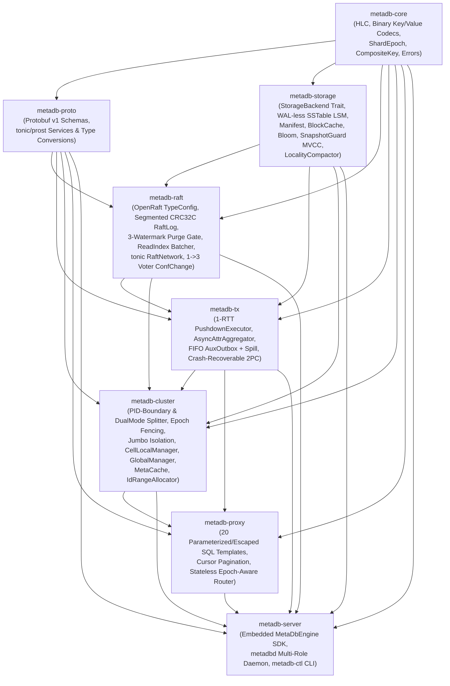

# MetaDB Phased Rust Development Plan

* **Project**: `rustfs/MetaDB`
* **Language & Toolchain**: 100% Pure Rust (`edition = "2021"`, zero C/C++ FFI)
* **Async & Distributed Stack**: `tokio` + `tonic` / `prost` (gRPC) + `openraft` (Multi-Raft)
* **Design Methodology**: [Google Elephant-Goldfish Model (EGM)](https://github.com/google/elephant-goldfish-model)
* **Companion Specifications**:
  * [`../Architecture.md`](../Architecture.md) — Master Architecture Specification
  * [`./designs/SITEMAP.md`](./designs/SITEMAP.md) — EGM Design Index
  * [`./designs/storage_lsm_mvcc.md`](./designs/storage_lsm_mvcc.md) — Pure-Rust WAL-less LSM, In-Memory MVCC & Locality-Aware Compaction
  * [`./designs/consensus_and_transactions.md`](./designs/consensus_and_transactions.md) — OpenRaft Multi-Raft, 1-RTT Pushdown, Off-Critical-Path Queues & 2PC
  * [`./designs/sharding_and_control_plane.md`](./designs/sharding_and_control_plane.md) — Topology Sharding, Two-Tier Control Plane, Protobuf Contracts & SQL Templates

---

## 1. Baseline Assessment & Target Architecture

### 1.1 Current Repository Baseline (`v0.1.0-prototype`)
Prior to Phase 1 execution, the repository contains an initial 6-crate synchronous in-memory prototype (`metadb-core`, `metadb-storage`, `metadb-tx`, `metadb-cluster`, `metadb-proxy`, `metadb-server`) that validates core data-model concepts in RAM (`BTreeMap` / `VecDeque` backed `RaftLog` and `PersistentStoreInner`), without disk persistence, SSTables, `SnapshotGuard` isolation, `openraft` consensus, `tonic` gRPC networking, crash-recoverable 2PC intents, epoch fencing, or server/CLI binaries.

### 1.2 Target Production Workspace (8 Pure-Rust Crates)
Phases 1 through 6 evolve the repository step-by-step into an 8-crate asynchronous, crash-safe, production-grade distributed metadata engine with zero C/C++ FFI dependencies:

### 1.3 Workspace Engineering Rules (Enforced Across All Phases)
1. **100% Rust & 100% English**: Zero `unsafe` C/C++ bindings (`rocksdb` / `leveldb` FFI forbidden). All code, Rustdoc comments, error messages, commit messages, and technical specs must be written in English.
2. **Documentation Synchronization**: At the end of every phase, update the implementation status matrix in `Architecture.md`, `README.md`, and the five multilingual usage guide suites (`docs/guides/{en,ja,fr,zh,de}/`) to reflect newly landed capabilities accurately.
3. **Continuous Verification**: No phase may be marked complete unless `cargo fmt --all -- --check`, `cargo clippy --workspace --all-targets -- -D warnings`, and `cargo test --workspace` pass cleanly.
4. **Git Delivery Rule (Phase 6)**: When pushing verified milestones to GitHub from a worktree branch onto the repository default branch, push via `git push origin HEAD:main`.

---

## 2. Phase-by-Phase Implementation Plan

### Phase 0: Architecture, EGM Specifications, Goldfish Review & Multilingual Guides (Current Gate)
* **Objective**: Establish Zero-Decision architectural specifications, subsystem blueprints, phased engineering plan, adversarial zero-context Goldfish review resolutions, and 5-language user documentation (`en`, `ja`, `fr`, `zh`, `de`) before modifying Rust crate source code.
* **Deliverables**:
  * `Architecture.md`
  * `docs/DEVELOPMENT_PLAN.md`
  * `docs/designs/{SITEMAP.md, concepts_brief.md, metadb_architecture.md, storage_lsm_mvcc.md, consensus_and_transactions.md, sharding_and_control_plane.md, review_report.md}`
  * `_agents/skills/metadb_elephant/SKILL.md` and `README.md`
  * `docs/README.md` and `docs/guides/{en,ja,fr,zh,de}/{README.md, deployment.md, client-apis-and-sql.md, operations-and-tuning.md}`
* **Acceptance Criteria**:
  * Zero-context Goldfish review subagent completes full specification audit with zero unresolved blocking findings.
  * Existing prototype workspace continues to pass `cargo test --workspace` without code modifications.

---

### Phase 1: Core Binary Codecs, System Keyspaces & Protobuf/gRPC Contracts (`metadb-core` & `metadb-proto`)
* **Objective**: Solidify all deterministic binary encodings (including CRC32C framing, composite shard bounds, `ShardEpoch`, and internal transactional keyspaces `0x04..0x07`) in `metadb-core`, and introduce the `metadb-proto` crate defining wire protocols for single-node and multi-cell RPCs.
* **File Boundaries**:
  * `Cargo.toml` (add `crates/metadb-proto` and workspace dependencies `bytes`, `crc32c`, `thiserror`, `prost`, `tonic`, `tonic-build`, `tokio`, `serde`)
  * `crates/metadb-core/Cargo.toml`
  * `crates/metadb-core/src/{lib.rs, error.rs, hlc.rs, schema.rs, epoch.rs, system_keys.rs, checksum.rs}`
  * `crates/metadb-proto/Cargo.toml`
  * `crates/metadb-proto/build.rs`
  * `crates/metadb-proto/proto/metadb/v1/{common.proto, metadata.proto, transaction.proto, raft.proto, control_plane.proto}`
  * `crates/metadb-proto/src/{lib.rs, convert.rs}`
* **Key Invariants**:
  * Disjoint binary key prefixes: `0x01` (`MetaTable`), `0x02` (`QuotaTable`), `0x03` (`SecondaryIndexTable`), `0x04` (`DirShardDelta` for `DualModeFineGrained` sub-shards), `0x05` (`WriteIntent` for 2PC locks), `0x06` (`TxnRecord` for Primary-Anchored 2PC decisions), `0x07` (`SpilledAuxOutbox` for bounded Raft log retention).
  * Deterministic binary codecs with explicit format version byte and CRC32C validation for `InodeAttr`, `QuotaRecord` (including `applied_index_by_shard: BTreeMap<ShardId, u64>`), `SecondaryIndexRecord` (including `tombstone_hlc`), `WriteIntent`, `TxnRecord`, and `AuxUpdateTask`.
  * Bounded HLC clock-skew check (`max_clock_drift_ms`, default `500ms`) & 16-bit logical overflow safety: `HybridLogicalClock::update_checked(remote)` rejects timestamps drifting beyond `max_clock_drift_ms` ahead of local physical wall clock with `MetaDbError::ClockSkewExceeded`; if the 16-bit logical counter reaches `u16::MAX`, `HLC` increments the 48-bit physical component by `+1ms` (yielding briefly if approaching `max_clock_drift_ms`) and **never wraps `u16` to `0` at the same physical millisecond**.
  * `CompositeKeyBound` supporting both `PID`-boundary intervals `[ (start_pid, ""), (end_pid, "") )` and `DualModeFineGrained` `(PID, name)` intervals.
* **Verification Commands**:
  * `cargo test -p metadb-core -p metadb-proto`
  * `cargo clippy -p metadb-core -p metadb-proto --all-targets -- -D warnings`
* **Acceptance Criteria**:
  * Round-trip property/unit tests pass for every binary key/value codec, corrupted-byte CRC32C rejection, lexicographical byte ordering across `0x01..0x07`, HLC drift rejection, and Protobuf `<->` `metadb-core` domain conversions.

---

### Phase 2: Pure-Rust WAL-less LSM Engine, `SnapshotGuard` MVCC & Locality-Aware Compaction (`metadb-storage`)
* **Objective**: Replace the in-memory `PersistentStoreInner` mock with a real disk-backed pure-Rust sorted LSM engine behind a clean `StorageBackend` trait, paired with `SnapshotGuard`-protected `MemMvccStore`, Coordinated Flush Barrier hooks, and bottommost-safe `LocalityCompactor`.
* **Detailed Specification**: [`./designs/storage_lsm_mvcc.md`](./designs/storage_lsm_mvcc.md)
* **File Boundaries**:
  * `crates/metadb-storage/Cargo.toml`
  * `crates/metadb-storage/src/{lib.rs, backend.rs, sstable.rs, block.rs, bloom.rs, cache.rs, manifest.rs, version_set.rs, mvcc.rs, compaction.rs, engine.rs}`
  * `crates/metadb-storage/tests/{lsm_recovery_tests.rs, mvcc_snapshot_tests.rs, locality_compaction_tests.rs}`
* **Key Invariants**:
  * **WAL-less Persistence**: `LsmStorageBackend` writes zero KV WAL files; durability before flush is owned by the Raft log, and `lsm_flushed_index` advances strictly after `L0` SSTable `fdatasync` + `MANIFEST` `fdatasync` + parent directory `fsync`.
  * **SSTable Integrity**: 4 KiB prefix-compressed data blocks with 16-entry restart intervals, per-block CRC32C trailers, Kirsch-Mitzenmacher Bloom filter (`10 bits/key` indexing both live values and `PhysicalTombstone`s), sparse block index, length-framed `MetaBlock` with monotonic `flush_generation: u64`, and canonical **64-byte** magic/version/checksum footer.
  * **Mathematical MVCC Visibility (`SnapshotGuard` & `ReadCut`)**: `SnapshotGuard` pins a total `ReadCut { max_raft_index, max_hlc }` + `Arc<Version>` + `Vec<Arc<ImmMemTable>>` with bounded per-page step leases. An `ImmMemTable` covering writes up to `H_imm` flushes to an unversioned L0 SSTable **only when** `min_active_snapshot_hlc >= H_imm` (`<= 5,000ms` timeout), guaranteeing zero future-read/phantom-scan anomalies and zero persisted MVCC tombstones.
  * **Bottommost-Safe Locality Compaction**: `LocalityCompactor` tracks tombstone density per 9-byte `[table_prefix][group_key: 8B]` bucket and compacts `[start_key, end_key)` across all overlapping levels (`L0..L_max`), dropping `PhysicalTombstone` entries **only** when no deeper overlapping SSTable can contain the key.
* **Verification Commands**:
  * `cargo test -p metadb-storage`
  * `cargo clippy -p metadb-storage --all-targets -- -D warnings`
* **Acceptance Criteria**:
  * Crash/reopen tests verify `MANIFEST` recovery, orphan `.sst.tmp` cleanup, CRC32C corruption detection, Bloom filter zero false-negatives, `SnapshotGuard` isolation across concurrent `MemTable` seals and L0 flushes, `~60%` KV write reduction on rapid updates/deletes, and zero shadowed-key resurrection during multi-level `LocalityCompactor` runs.

---

### Phase 3: OpenRaft Multi-Raft Consensus, 3-Watermark Log Storage & Linearizable `ReadIndex` (`metadb-raft`)
* **Objective**: Build `metadb-raft` on `openraft` to unify Stage 1 (`1-Voter` single-node) and Stage 3 (`3-Voter` distributed Multi-Raft) behind segmented CRC32C Raft logs, 3-watermark truncation safety, snapshot streaming, `tonic` gRPC transport, and batched `ReadIndex`.
* **Detailed Specification**: [`./designs/consensus_and_transactions.md`](./designs/consensus_and_transactions.md) (§1–§4)
* **File Boundaries**:
  * `crates/metadb-raft/Cargo.toml`
  * `crates/metadb-raft/src/{lib.rs, types.rs, log_store.rs, state_machine.rs, network.rs, read_index.rs, group_host.rs, conf_change.rs}`
  * `crates/metadb-raft/tests/{single_voter_recovery_tests.rs, multi_raft_failover_tests.rs}`
* **Key Invariants**:
  * **Segmented CRC32C Raft Log**: Append-only segment files (`segment_<first_index:020>.raftlog`) with `fdatasync` on batch append, persistent `HardState` (`voted_for`, `current_term`), and torn-tail recovery on startup.
  * **3-Watermark Safe Purge Gate**: OpenRaft log purge is clamped to `safe_purge_index = min(state_flushed_index, aux_outbox_durable_index, last_snapshot_index)`, where `state_flushed_index` advances atomically only when both `MemMvccStore` and folded `AsyncAttrAggregator` updates up to `M` are durable in L0 SSTables + `MANIFEST`.
  * **Online Membership Evolution (`1-Voter -> 3-Voter`)**: `ConfChangeOrchestrator` executes `AddLearner(node_id)` -> verifies snapshot/log replication lag `< learner_promote_threshold_entries` -> executes joint-consensus `ChangeMembership` promoting learners to `Voter`s without write downtime.
  * **Linearizable Reads**: `ShardRaftNode::linearizable_read()` uses OpenRaft `ensure_linearizable()` with request coalescing (`ReadIndexBatcher`), resolving locally in `0` network hops for `1-Voter` groups and `1` quorum heartbeat RTT for `3-Voter` groups.
* **Verification Commands**:
  * `cargo test -p metadb-raft`
  * `cargo clippy -p metadb-raft --all-targets -- -D warnings`
* **Acceptance Criteria**:
  * Automated tests pass for `1-Voter` WAL-less crash recovery (verifying un-flushed MemTable state replays cleanly from Raft segments), 3-watermark log pinning and release, `1-Voter -> Learner -> 3-Voter` live promotion under concurrent writes, leader kill/re-election, and stale-leader read fencing.

---

### Phase 4: Replicated Pushdown Execution, Off-Critical-Path Queues & Crash-Recoverable 2PC (`metadb-tx`)
* **Objective**: Refactor `metadb-tx` so all single-shard pushdown operations, `AsyncAttrAggregator` deltas, `AuxOutbox` tasks, and Primary-Anchored 2PC transactions execute deterministically through `metadb-raft`'s state machine with full crash recovery.
* **Detailed Specification**: [`./designs/consensus_and_transactions.md`](./designs/consensus_and_transactions.md) (§5–§8)
* **File Boundaries**:
  * `crates/metadb-tx/Cargo.toml`
  * `crates/metadb-tx/src/{lib.rs, state_machine_impl.rs, pushdown.rs, attr_aggregator.rs, aux_outbox.rs, two_pc.rs, recovery_worker.rs}`
  * `crates/metadb-tx/tests/{attr_reconcile_race_tests.rs, aux_idempotency_tests.rs, two_pc_crash_tests.rs}`
* **Key Invariants**:
  * **Coordinated Flush Barrier for `AsyncAttrAggregator`**: Folded `(PID, "_attr_")` updates (`applied_index = M`) are written inside the exact same L0 SSTable flush batch up to `raft_index = M`, and in-memory deltas `<= M` are pruned strictly after the new `Version` is published, preventing both crash data loss and read-reconciliation double/under-counting.
  * **Authoritative `rmdir` & `DeletingDir` Intent**: Single-shard `rmdir` scans `[target_dir_id, target_dir_id + 1)` inside deterministic Raft `apply`; cross-shard `rmdir` locks `(target_dir_id, "_attr_")` with `WriteIntent::DeletingDir` during 2PC Prepare so concurrent `create_file(target_dir_id, ...)` cannot race between emptiness check and commit.
  * **Exact-Once `AuxOutbox` with Local Overflow Spill**: Tasks dispatch in strict FIFO `origin_raft_index` order per `(origin_shard_id, target_shard_id)`; overdue tasks spill to `[0x07]` (`SpilledAuxOutbox`) during MemTable flush so Raft logs never stall; `QuotaTable` deduplicates via `applied_index_by_shard[origin_shard_id]` and `SecondaryIndexTable` via monotonic `(last_applied_hlc, tombstone_hlc)`.
  * **Crash-Recoverable Primary-Anchored 2PC**: Supports cross-shard `Rename` (both exclusive and POSIX overwrite), cross-shard `Mkdir`, and cross-shard `Rmdir`. Primary Shard atomically commits `TxnRecord::Committed { commit_hlc }` (`[0x06]`) + primary `WriteIntent` resolution (`[0x05]`); `TxnRecoveryWorker` rolls forward committed secondaries and aborts expired pending transactions (`ttl_ms = 3,000ms < 5,000ms`).
* **Verification Commands**:
  * `cargo test -p metadb-tx`
  * `cargo clippy -p metadb-tx --all-targets -- -D warnings`
* **Acceptance Criteria**:
  * Fault-injection tests pass for coordinator crashes before/after Primary Commit, concurrent `rename(A->B)` vs `rename(B->A)` conflict resolution without deadlock, concurrent `rmdir` vs `create_file` across shards, leader failover mid-`AuxOutbox` drain, and concurrent `dirstat` during L0 flush barriers.

---

### Phase 5: Epoch-Fenced Topology Sharding, Jumbo Dual-Mode & Two-Tier Control Plane (`metadb-cluster` & `metadb-proxy`)
* **Objective**: Upgrade `metadb-cluster` and `metadb-proxy` to distributed gRPC-capable routing with `ShardEpoch` fencing, Raft-replicated `ExecuteSplit` (`PID`-boundary + `DualModeFineGrained` scatter-gather), distributed `IdRangeAllocator`, Two-Tier Control Plane RPCs, and all 20 parameterized/escaped SQL templates.
* **Detailed Specification**: [`./designs/sharding_and_control_plane.md`](./designs/sharding_and_control_plane.md)
* **File Boundaries**:
  * `crates/metadb-cluster/Cargo.toml`
  * `crates/metadb-cluster/src/{lib.rs, shard.rs, split_worker.rs, jumbo.rs, id_allocator.rs, meta_cache.rs, cell_manager.rs, global_manager.rs}`
  * `crates/metadb-proxy/Cargo.toml`
  * `crates/metadb-proxy/src/{lib.rs, sql_lexer.rs, sql_templates.rs, router.rs}`
  * `crates/metadb-cluster/tests/{epoch_split_tests.rs, dual_mode_jumbo_tests.rs}`
  * `crates/metadb-proxy/tests/sql_templates_tests.rs`
* **Key Invariants**:
  * **Epoch Fencing**: Every shard mutation/read checks `ShardEpoch { conf_ver, version }`; stale routes return `EpochMismatch { latest_descriptor }` and trigger transparent `MetaCache` refresh + retry.
  * **Dual-Mode Fine-Grained Sharding**: When enabled on a Jumbo `PID`, splits along `(PID, name)` boundaries initialize `DirShardDelta` (`[0x04][pid: 8B BE]`) on non-anchor sub-shards so `create_file`/`unlink` remain lock-free `1-RTT` single-shard ops, `dirstat(PID)` executes a `1-hop` parallel scatter-gather across sub-shards of `PID`, and `listdir(PID, after_name, limit)` streams cursor-paginated pages across sub-shards.
  * **Complete 20-Template SQL Compiler**: Lexer-backed parser supporting escaped quotes, `?` positional bind parameters, cursor-paginated `listdir`, POSIX/exclusive `rename`, `setattr`/`chmod`/`chown`/`utimes`, and `QuotaTable` / `SecondaryIndexTable` point & range queries.
* **Verification Commands**:
  * `cargo test -p metadb-cluster -p metadb-proxy`
  * `cargo clippy -p metadb-cluster -p metadb-proxy --all-targets -- -D warnings`
* **Acceptance Criteria**:
  * Tests verify concurrent client writes during live `PID`-boundary shard splits (`EpochMismatch` auto-retry with zero lost/duplicate writes), Jumbo Shard dedicated-node isolation, `DualModeFineGrained` scatter-gather `dirstat` + paginated `listdir` + 2PC `rmdir`, `IdRangeAllocator` uniqueness across restarts, and all 20 SQL templates.

---

### Phase 6: Unified `metadbd` Daemon, `metadb-ctl` CLI, End-to-End Evolution & Benchmark Suite (`metadb-server`)
* **Objective**: Deliver the full `metadb-server` library SDK, standalone/distributed `metadbd` gRPC server binary, `metadb-ctl` administration & benchmark CLI, graceful shutdown, observability metrics, and end-to-end Stage 1 -> Stage 2 -> Stage 3 cluster evolution tests.
* **File Boundaries**:
  * `crates/metadb-server/Cargo.toml`
  * `crates/metadb-server/src/{lib.rs, config.rs, grpc_services.rs, metrics.rs}`
  * `crates/metadb-server/src/bin/{metadbd.rs, metadb-ctl.rs}`
  * `crates/metadb-server/tests/{integration_tests.rs, e2e_cluster_evolution_tests.rs}`
  * Documentation status updates across `Architecture.md`, `README.md`, and `docs/guides/{en,ja,fr,zh,de}/`
* **Key Invariants**:
  * **Single Codebase Across Deployment Topologies**: `metadbd --role all-in-one` runs `GlobalManager + CellLocalManager + MetaCache + Proxy + BE (1-Voter OpenRaft)` in one process; `--role global-manager | cell-manager | be | proxy` runs disaggregated multi-node / multi-Cell clusters over `tonic` gRPC.
  * **Clean Lifecycle**: Graceful SIGINT/SIGTERM drain flushes active MemTables, persists `MANIFEST` and Raft state, and closes network listeners cleanly.
* **Verification Commands**:
  * `cargo fmt --all -- --check`
  * `cargo clippy --workspace --all-targets -- -D warnings`
  * `cargo test --workspace`
* **Acceptance Criteria**:
  * End-to-end integration suite boots a persistent `1-Voter` `metadbd` node on disk, restarts and verifies crash recovery, splits shards across `PID` boundaries, joins two additional `metadbd` BE nodes over real local TCP/gRPC sockets, promotes shards to `3-Voter` Multi-Raft under live load, adds a second `Cell`, executes cross-shard 2PC `rename` and bulk-delete `LocalityCompactor` scans via `metadb-ctl` and gRPC clients, and updates all documentation status tables to `Implemented`.
