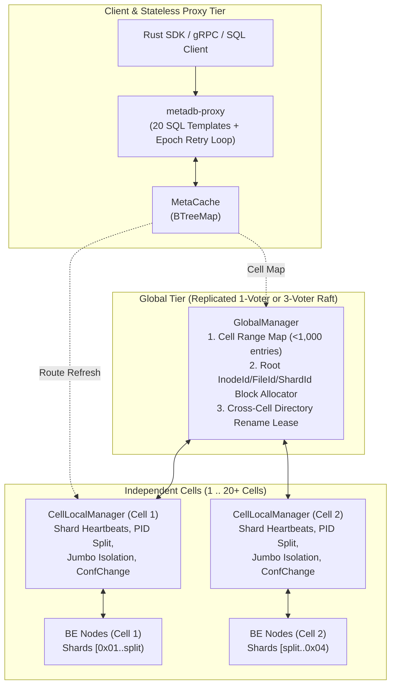

# EGM Subsystem Specification 3: Epoch-Fenced Topology Sharding, Jumbo Dual-Mode, Two-Tier Control Plane & Wire Protocols (`metadb-proto`, `metadb-cluster` & `metadb-proxy`)

* **Status**: Phase 0 Approved Specification
* **Target Crates**: `crates/metadb-proto`, `crates/metadb-cluster`, and `crates/metadb-proxy`
* **Primary Reference**: Zebin Ren ([@ZebinRen](https://github.com/ZebinRen)), Biao Cao, Kang Chen ([@kangchenPKU](https://github.com/kangchenPKU)), Zhihui Yin, Qiushi Chen, Jielong Jian, Jiwei Xiong, Xinxing Wang, Yan Xing, Liguo Duan, Ran Zheng, Xianjun Meng, and Zhenyu Hou, *"MetaDB: Putting File-System Structure Back into Distributed Databases"*, [arXiv:2610.32247v1](https://arxiv.org/html/2610.32247v1) (Vrije Universiteit Amsterdam, Baidu & Peking University, 2026), §3.1, §3.2, §4.1, §8
* **Semantic Boundaries**:
  * `FeatureRange`: Sections 1 – 4
  * `DetailedRange` (Zero-Decision Implementation Contract): Sections 5 – 10

---

## 1. Problem Statement (`FeatureRange`)

Scaling a file-system metadata engine from a single embedded node (`10^6` entries) to a `1,000+` node cluster (`10^{12}–10^{13}` entries) exposes four distributed control-plane and routing challenges:
1. **Mid-Directory Splits vs. Jumbo Shards**: Naive byte-midpoint shard splits slice directories in half (destroying `1-RTT` single-shard pushdown), whereas strict `group_key = PID` colocation creates unsplittable **Jumbo Shards** when a single directory holds hundreds of millions of files.
2. **Stale Routing During Live Splits & Rebalances**: Stateless proxies caching shard locations can send writes to a shard whose range just shrunk or whose Raft membership changed.
3. **Single-Manager Heartbeat Bottleneck**: A single central cluster manager tracking heartbeats for `450,000+` shards saturates Raft consensus and network I/O, while proxy restarts trigger routing-table thundering herds.
4. **Heavyweight SQL Compilation Overhead**: Parsing metadata queries through a full general-purpose SQL AST + cost-based optimizer burns `30%–50%` of proxy CPU on `~20` fixed query shapes.

---

## 2. Goals & Non-Goals (`FeatureRange`)

### Goals
* **G1 (Unified `[0x01, 0x04)` User Keyspace & `ShardEpoch` Fencing)**: Partition `MetaTable` (`0x01`), `QuotaTable` (`0x02`), and `SecondaryIndexTable` (`0x03`) across contiguous byte intervals `[start_key, end_key)` protected by `ShardEpoch { conf_ver, version }`.
* **G2 (Raft-Replicated `PID`-Boundary Splits & Two-Level Jumbo Defense)**: Split `MetaTable` shards cleanly on `[0x01][pid: 8B BE]` boundaries via deterministic `RaftCmd::ExecuteSplit`; isolate single-`PID` Jumbo Shards onto dedicated BE nodes (`JumboIsolated`); and provide `DualModeFineGrained` `(PID, name)` splitting with shard-local `DirShardDelta` (`[0x04]`) so writes stay `1-RTT` lock-free and `dirstat` uses `1-hop` parallel scatter-gather.
* **G3 (Two-Tier Control Plane + `MetaCache` + Hierarchical `IdRangeAllocator`)**: Partition cluster management into `GlobalManager` (coarse `[start_key, end_key) -> CellId` table + global ID block allocation) and per-Cell `CellLocalManager`s (`20K–50K` shards/Cell), fronted by `MetaCache`.
* **G4 (Complete 20-Template SQL Compiler & Protobuf v1 Contracts)**: Compile all 20 parameterized/escaped metadata SQL templates in `<5µs` and expose typed `tonic` gRPC services (`MetadataService`, `TransactionService`, `RaftTransportService`, `ControlPlaneService`).

### Non-Goals
* **NG1**: Dynamic ad-hoc secondary index creation (`CREATE INDEX ...`) or cross-table SQL `JOIN`s.

---

## 3. High-Level Control Plane & Sharding Topology (`FeatureRange`)



---

## 4. Alternatives Considered & Risks (`FeatureRange`)

* **Alternatives Rejected**:
  * *Hash Sharding on `(PID, name)`*: Rejected because hashing scatters sibling entries across every shard in the cluster, turning every `listdir(pid)` into a full-cluster fan-out scan and every `create`/`unlink` with parent attribute checks into cross-shard coordination.
  * *Forcing Synchronous 2PC on Every `create_file` in `DualModeFineGrained`*: Rejected because locking `(PID, "_attr_")` on the Anchor Sub-Shard would recreate the exact hotspot bottleneck that caused the directory to become a Jumbo Shard. Maintaining shard-local `DirShardDelta` (`[0x04]`) preserves `1-RTT` lock-free writes while keeping `dirstat` linearizable via parallel scatter-gather.
* **Risks & Mitigations**:
  * *Split Racing with In-Flight `2PC` Intents*: Before proposing `RaftCmd::ExecuteSplit` at `split_key`, the shard leader checks `[0x05]` (`WriteIntent`) in `[split_key, end_key)`. If active intents exist, split either waits for them to resolve (`<= 3s` TTL) or aborts expired intents before committing `ExecuteSplit`, ensuring a child shard never inherits half-prepared untracked locks without bumping `ShardEpoch.version`.

---

## 5. Unified Keyspace, `ShardEpoch` Fencing & Split State Machine (`DetailedRange`)

### 5.1 Unified User-Key Interval `[0x01, 0x04)`
Every `ShardDescriptor` owns an half-open binary user-key interval `[start_key: Vec<u8>, end_key: Vec<u8>)`:
* At cluster bootstrap (`Cell 1`), three initial root shards are created (or a single root shard `[0x01] .. [0x04]` in minimal single-shard embedded mode, configurable via `bootstrap_table_shards: bool`, default `true` = 3 table-aligned shards):
  * `Shard 1` (`MetaTable`): `start_key = [0x01]`, `end_key = [0x02]` (and pre-populates `(ROOT_INODE_ID = 1, "_attr_")`).
  * `Shard 2` (`QuotaTable`): `start_key = [0x02]`, `end_key = [0x03]`.
  * `Shard 3` (`SecondaryIndexTable`): `start_key = [0x03]`, `end_key = [0x04]`.
* Note: Shard-internal system keys (`0x04 DirShardDelta`, `0x05 WriteIntent`, `0x06 TxnRecord`, `0x07 SpilledAuxOutbox`) reside inside each shard's isolated `LsmStorageBackend` directory (`shards/<shard_id>/lsm/`) and are **not** routed through `MetaCache`.

### 5.2 `ShardEpoch` Fencing Rules (Strict `(conf_ver, version)` Equality)
```rust
#[derive(Debug, Clone, Copy, PartialEq, Eq, PartialOrd, Ord, Hash)]
pub struct ShardEpoch {
    /// Incremented by 1 on every Raft ConfChange (AddLearner, ChangeMembership).
    pub conf_ver: u64,
    /// Incremented by 1 on every key-range mutation (ExecuteSplit).
    pub version: u64,
}
```
1. Every shard RPC (`PushdownOp`, `Prepare2pc`, `ReadIndex` query, `ApplyAuxBatch`, `TransferLeader`, `ChangeMembership`) includes `(shard_id, expected_epoch: ShardEpoch)`.
2. **Strict Double Check on Both `conf_ver` and `version`**:
   * *Pre-Proposal Check*: Reject immediately with `MetaDbError::EpochMismatch { current: ShardDescriptor, split_child_hint: Option<ShardDescriptor> }` if **`expected_epoch != local_desc.epoch` (`conf_ver != local.conf_ver || version != local.version`)** or target key $\notin [start\_key, end\_key)$. If not Raft leader, return `MetaDbError::NotLeader { shard_id, leader_hint }`.
   * *Deterministic `apply` Check*: Re-verify **`expected_epoch == state_machine_desc.epoch`** inside `RaftStateMachine::apply`! Any `ExecuteSplit` (`version` bump) or `ConfChange` (`conf_ver` bump) committed ahead of an in-flight proposal deterministically fences the stale entry on all replicas without mutating state.
3. **Proxy/SDK Self-Healing Retry**: Upon `EpochMismatch { current, split_child_hint }` or `NotLeader { leader_hint }`, `metadb-proxy` updates `MetaCache` (inserting both `current` and `split_child_hint` when present, or refreshing from `CellLocalManager`) and retries transparently (up to `max_route_retries = 5`).

### 5.3 Recoverable Multi-Step `ExecuteSplit` State Machine (`PID`-Boundary & `DualModeFineGrained`)
1. **Boundary Discovery (`PolicyShardSplitter`)**:
   * Triggered when shard live + SSTable bytes `>= shard_split_threshold_bytes`.
   * Reads SSTable `IndexBlock` entries (no `DataBlock` disk reads) to build a cumulative byte histogram:
     * For `0x02` (`QuotaTable`) / `0x03` (`SecondaryIndexTable`): picks midpoint 9-byte key `[prefix][id: 8B BE]`.
     * For `0x01` (`MetaTable`) in `ShardSplitMode::DirectoryColocated`: groups index keys by 9-byte prefix `[0x01][pid: 8B BE]`. If a valid `split_pid` exists with `>= 10%` bytes on both sides, selects `split_key = [0x01][split_pid: 8B BE]`; otherwise emits `UnsplittableJumboShard { shard_id, dominant_pid }`.
     * For `0x01` (`MetaTable`) when `dominant_pid` has `DualModeFineGrained` enabled: selects midpoint full `MetaKey` `split_key = [0x01][dominant_pid: 8B BE][split_name_utf8]` (ensuring `split_name != "_attr_"`).
2. **Stage A — Durable Control-Plane Registration & Intent Drain (`Planned`)**:
   * Parent leader calls `CellLocalManager::AllocSplitPlanRpc { request_uuid, parent_shard_id, split_key, target_version: old_version + 1 }`—which durably allocates `new_shard_id` (from `CellLocalManager`'s `GlobalManager`-leased `ShardId` pool) and persists `SplitPlanRecord::Planned` in `CellLocalManager`'s Raft log before replying.
   * Parent leader scans the **prefixed intent range `concat([0x05], split_key) .. concat([0x05], old_end_key)`** (plus `(dominant_pid, "_attr_")` / `[0x04][dominant_pid]` if splitting inside `dominant_pid`): aborts expired intents, and if any live non-expired `[0x05]` intent or `deleting_fence == true` (`Rmdir` in progress) exists, defers `ExecuteSplit` by `500ms` (`<= 3s` TTL).
   * Parent leader triggers a Coordinated Flush Barrier on `S_parent` so `MemMvccStore` and `AsyncAttrAggregator` deltas are flushed to SSTables.
3. **Stage B — Idempotent Local Child Materialization & `NODE_SHARD_REGISTRY` (`ChildBootstrapped`)**:
   * Proposed Payload: `ExecuteSplit { new_shard_id, split_key, split_mode, new_version: old_version + 1 }`.
   * On every replica inside `apply(ExecuteSplit)`:
     1. Record `PendingChildBoot { new_shard_id, parent_shard_id, child_descriptor }` in `<data_dir>/NODE_SHARD_REGISTRY` (`fdatasync`). If `shards/<new_shard_id>/lsm/` was already atomically finalized on an earlier replay, skip step 2–3 idempotently.
     2. **Partition All Shard Keyspaces by Logical `affinity_key` into `shards/<new_shard_id>.splitting/lsm/`**:
        * `0x01..0x03` (User tables): `affinity_key = raw_user_key` (`< split_key` stays in `S_parent`; `>= split_key` moves to `S_child`).
        * `0x04` (`DirShardDelta`): `affinity_key = [0x01][pid: 8B BE]`. Moved to `S_child` if `[0x01][pid] >= split_key`; if `split_key` splits inside a `DualModeFineGrained` directory `P` (including re-splitting an already non-anchor sub-shard of `P`!), read base `(inode_id, parent_pid, uid, mode, create_time)` from `(P, "_attr_")` (if `S_parent` was Anchor) or from `S_parent`'s existing `[0x04][P]` (if `S_parent` was non-anchor), scan live `0x01` entries of `P` in both halves to compute exact `(left_children, left_bytes, left_max_mtime)` and `(right_children, right_bytes, right_max_mtime)`, update `(P, "_attr_")` on whichever half covers `MetaKey::dir_attr(P)` (Anchor), and write `[0x04][P]` on every non-anchor half (`deleting_fence = false`).
        * `0x05` (`WriteIntent`): `affinity_key = target_user_key` (`raw_key[1..]`). Partitioned at `split_key` alongside its target user key.
        * `0x06` (`TxnRecord`): `affinity_key = record.primary_key`. Partitioned at `split_key` so `MetaCache::route_key(&primary_key)` always locates `TxnStatusRecord`.
        * `0x07` (`SpilledAuxOutbox`) & pre-split `AuxOutbox`: **retained exclusively by `S_parent` (`origin_shard_id = parent_shard_id`)** until contiguously ACKed.
     3. **Crash-Safe Atomic Directory Activation**: `fdatasync` `S_child`'s initial SSTable + `MANIFEST`, atomically `rename("shards/<new_shard_id>.splitting", "shards/<new_shard_id>")` + `fsync(shards_dir)`, then delete migrated keys (`>= split_key`) and update `S_parent`'s `DurableShardCheckpoint` (`end_key = split_key, epoch.version = new_version`, caching `split_child_hint = child_descriptor`).
     4. `ShardGroupHost` boots local `S_child` OpenRaft instance (`epoch = { conf_ver: 1, version: new_version }`) and transitions `NODE_SHARD_REGISTRY` entry to `Active` (`ShardGroupHost::recover_all_shards()` resumes any `PendingChildBoot` automatically on node restart).
4. **Stage C — Control-Plane Activation (`Activated`)**:
   * `S_parent` / `S_child` leader calls `CellLocalManager::ActivateSplitRpc` (and re-reports via `3s` `StoreHeartbeat` until acknowledged), transitioning `SplitPlanRecord -> Activated` and refreshing `MetaCache`.

### 5.4 `DualModeFineGrained` Operations & Keyset Pagination Contract
* **`CreateFile(P, name)` / `Unlink(P, name)` / `SetAttr(File: P, name)`**: Routed directly to `S_k = MetaCache::route_key(MetaKey::child(P, name))` in `1 RTT`. (`SetAttr` on a **Directory** `(P, dir_name)` updates `(dir_name_id, "_attr_")` authoritatively via `1 RTT` if colocated or `2PC` across `(P, dir_name)`, `(dir_name_id, "_attr_")`, and any `[0x04][dir_name_id]` sub-shards).
* **`DirStat(P)` with Shared `ReadCut` (`barrier_hlc`)**:
  1. Proxy executes parallel `ReadIndex` across sub-shards `S_1 .. S_K` covering `[[0x01][P], [0x01][P+1])`, collecting `(max_applied_hlc_i, current_epoch_i)`.
  2. Sets `barrier_hlc = max(clock.now(), max_i(max_applied_hlc_i))`. Each `S_i` runs `clock.update_checked(barrier_hlc)` + `ReadIndex` + `acquire_fixed_snapshot(barrier_hlc)` (`GetDirPartitionStat`), guaranteeing zero future writes `<= barrier_hlc` and evaluating all `K` sub-shards at the **exact same immutable cut** (retrying if any `EpochMismatch` occurs).
* **`ListDir(P, after_name, limit)` Keyset Continuation Contract**: Each page executes a linearizable `ReadIndex` + bounded `SnapshotGuard` scan returning up to `limit` sorted live child entries strictly `> after_name` (excluding `"_attr_"`). Across separate page RPCs, standard POSIX `readdir` / S3 `ListObjectsV2` keyset continuation semantics apply (monotonically increasing names with zero intra-page duplicates and guaranteed termination; concurrent inserts/deletes between separate page RPCs do not pin multi-second MVCC snapshots).
* **`Rmdir(parent_pid, dir_name)` for `DualModeFineGrained` `P`**: Executes 2PC across `Shard(parent_pid, dir_name)` and all `S_1 .. S_K` covering `[P, P+1)`: Prepare sets `deleting_fence = true` (`DeletingDir` intent) on every sub-shard after verifying `0` live children on every sub-shard; Commit deletes `(parent_pid, dir_name)`, `(P, "_attr_")`, and all `[0x04][P]` records.

---

## 6. Two-Tier Control Plane & Hierarchical `IdRangeAllocator` (`DetailedRange`)

### 6.1 `CellLocalManager` (`crates/metadb-cluster/src/cell_manager.rs`)
* Receives `StoreHeartbeat` every `3s` from each BE node in its Cell containing `(node_capacity, disk_free, cpu_load, Vec<ShardStats { shard_id, epoch, role, approx_bytes, qps, is_jumbo, dominant_pid }>)`.
* **Jumbo Isolation Scheduler**: When a shard reports `UnsplittableJumboShard { dominant_pid }`:
  1. Transitions shard state to `JumboIsolated { dedicated_node, dominant_pid }`.
  2. Selects the lowest-loaded BE node (or a newly joined spare node), migrates leadership/voter replica of the Jumbo Shard there if needed, and issues `TransferLeader` + `ChangeMembership` commands to drain non-jumbo shards off `dedicated_node`.
  3. If `approx_bytes > auto_dual_mode_threshold_bytes` (optional policy knob, disabled by default unless operator-approved or configured), automatically triggers `DualModeFineGrained` split.

### 6.2 `GlobalManager` & Durable `IdRangeAllocator` (`crates/metadb-cluster/src/global_manager.rs`)
* Maintains:
  1. `cell_ranges: BTreeMap<Vec<u8>, CellRoute>` mapping coarse `[start_key, end_key)` to `(cell_id, cell_manager_endpoints)`.
  2. Monotonic Raft-persisted high-water marks `{ next_inode_id, next_file_id, next_shard_id, next_cell_id, rename_fence_token }` (initialized with `next_inode_id = 2` since `0 = Invalid`, `1 = ROOT_INODE_ID`).
* **Durable Idempotent Write-Before-Grant Lease Rule**:
  * Both `GlobalManager` (replicated OpenRaft state machine granting `65,536`-ID `InodeId`/`FileId` blocks and `1,024`-ID `ShardId` blocks) and `CellLocalManager` (replicated OpenRaft state machine sub-allocating `4,096`-ID File blocks, `256`-ID shard-affinity Directory blocks, and single `new_shard_id`s in `AllocSplitPlanRpc`) **commit the high-water-mark increment + caller `request_uuid: u128` idempotency record in their Raft log (`fdatasync`) BEFORE returning any grant**. Duplicate RPC retries with the same `request_uuid` return the cached immutable block; crashes never re-issue overlapping IDs.
  * **64-Bit `InodeId` Bitspace Partitioning**:
    * `ROOT_INODE_ID = 1`.
    * **Regular File `InodeId`s**: Bit `63 = 1` (`0x8000_0000_0000_0000 | global_file_inode_seq`), because regular files are never used as `PID` in `MetaKey(pid, name)`.
    * **Directory `InodeId`s (`PID`s)**: Bit `63 = 0` (`2 .. 0x7FFF_FFFF_FFFF_FFFF`). `CellLocalManager` tracks unallocated `PID` sub-intervals within each shard's `[start_pid, end_pid)` and leases disjoint `256`-ID directory blocks to `Shard(parent_pid)` (falling back to global `PID` blocks if a dense shard range has zero unallocated headroom), ensuring `>95%` of `mkdir`/`rmdir` execute in **single-shard `1 RTT`** with zero `InodeId` collisions.

---

## 7. Complete 20 Metadata SQL Templates (`metadb-proxy`, `DetailedRange`)

`SqlTemplateCompiler` uses a zero-copy tokenizing SQL lexer supporting single-quoted string literals with `''` / `\'` escaping and positional `?` bind parameters, compiling directly into `MetadataPlan`.

* **Strict `_attr_` Isolation Rule**:
  * Range and prefix directory listing templates (#9, #10, #11—even when a caller specifies `LIKE '_%'` or `LIKE '_attr_%'`) **unconditionally filter out `MetaKey::is_attr_key()` (`name == "_attr_"`)** so internal directory attribute records are never exposed as child entries.
  * Child point-lookup and mutation templates (#1–#6, #8, #12–#15) validate `validate_user_entry_name(name)` and reject `'_attr_'` with `MetaDbError::ReservedEntryName`; only explicit `DirStat` Template #7 (`WHERE pid = ? AND name = '_attr_'`) accesses directory attributes.

| # | Category | Canonical SQL Template | Compiled Execution Plan |
| :--- | :--- | :--- | :--- |
| 1 | Namespace Write | `INSERT INTO MetaTable (pid, name, id, type, fid, uid, mode, size) VALUES (?, ?, ?, 'FILE', ?, ?, ?, ?)` | `Pushdown::CreateFile` (`1 RTT`) |
| 2 | Namespace Write | `INSERT INTO MetaTable (pid, name, id, type, uid, mode) VALUES (?, ?, ?, 'DIR', ?, ?)` | `Pushdown::Mkdir` (`1 RTT` or `2PC`) |
| 3 | Namespace Write | `DELETE FROM MetaTable WHERE pid = ? AND name = ?` | `Pushdown::Unlink` (`1 RTT`) |
| 4 | Namespace Write | `RMDIR FROM MetaTable WHERE pid = ? AND name = ?` | `Pushdown::Rmdir` (`1 RTT` or `2PC` authoritative scan) |
| 5 | Rename | `UPDATE MetaTable SET pid = ?, name = ? WHERE pid = ? AND name = ?` | `Rename { overwrite: false }` (`1 RTT` or `2PC`) |
| 6 | Rename (POSIX) | `REPLACE INTO MetaTable (pid, name) SELECT ?, ? FROM MetaTable WHERE pid = ? AND name = ?` | `Rename { overwrite: true }` (`1 RTT` or `2PC`) |
| 7 | Point Read | `SELECT * FROM MetaTable WHERE pid = ? AND name = '_attr_'` | `DirStat` (`ReadIndex` + `reconcile_attr` / scatter-gather) |
| 8 | Point Read | `SELECT * FROM MetaTable WHERE pid = ? AND name = ?` | `Lookup` (`ReadIndex` point lookup) |
| 9 | Range Scan | `SELECT * FROM MetaTable WHERE pid = ? ORDER BY name ASC` | `ListDir { after: None, limit: DEFAULT_MAX }` |
| 10 | Paginated Scan | `SELECT * FROM MetaTable WHERE pid = ? AND name > ? ORDER BY name ASC LIMIT ?` | `ListDir { after: Some(cursor), limit }` |
| 11 | Prefix Scan | `SELECT * FROM MetaTable WHERE pid = ? AND name LIKE ? ORDER BY name ASC LIMIT ?` (prefix `'abc%'`) | `PrefixListDir { prefix, limit }` |
| 12 | Attr Mutation | `UPDATE MetaTable SET mode = ? WHERE pid = ? AND name = ?` | `Pushdown::SetAttr (chmod)` (`1 RTT`) |
| 13 | Attr Mutation | `UPDATE MetaTable SET uid = ? WHERE pid = ? AND name = ?` | `Pushdown::SetAttr (chown + Quota transfer)` (`1 RTT`) |
| 14 | Attr Mutation | `UPDATE MetaTable SET size = ?, fid = ? WHERE pid = ? AND name = ?` | `Pushdown::SetAttr (truncate/commit object + deltas)` (`1 RTT`) |
| 15 | Attr Mutation | `UPDATE MetaTable SET modify_time = ? WHERE pid = ? AND name = ?` | `Pushdown::SetAttr (utimes)` (`1 RTT`) |
| 16 | Quota | `SELECT * FROM QuotaTable WHERE uid = ?` | `GetQuota(uid)` (`ReadIndex` on `0x02` shard) |
| 17 | Quota | `INSERT INTO QuotaTable (uid, quota_limit_bytes) VALUES (?, ?) ON CONFLICT (uid) DO UPDATE SET quota_limit_bytes = ?` | `SetQuotaLimit { uid, limit_bytes }` |
| 18 | Quota Scan | `SELECT * FROM QuotaTable WHERE uid >= ? ORDER BY uid ASC LIMIT ?` | `ListQuotas { start_uid, limit }` |
| 19 | Reverse Index | `SELECT * FROM SecondaryIndexTable WHERE fid = ?` | `GetSecondaryIndex(fid)` (`ReadIndex` on `0x03` shard) |
| 20 | Reverse Index GC | `SELECT * FROM SecondaryIndexTable WHERE fid > ? ORDER BY fid ASC LIMIT ?` | `ScanSecondaryIndex { after_fid, limit }` |

---

## 8. Protobuf v1 / gRPC Service Contracts (`metadb-proto`, `DetailedRange`)

Defined under `crates/metadb-proto/proto/metadb/v1/`:
1. **`common.proto`**: `HlcTimestampProto`, `ShardEpochProto`, `ShardDescriptorProto`, `InodeAttrProto`, `MetaEntryProto`, `QuotaRecordProto`, `SecondaryIndexRecordProto`, `ErrorDetailProto` (structured `EpochMismatch`, `NotLeader`, `TransactionTimeout`, `WriteIntentConflict`).
2. **`metadata.proto` (`MetadataService`)**:
   * `CreateFile`, `Mkdir`, `Unlink`, `Rmdir`, `SetAttr`, `Lookup`, `DirStat`, `GetDirPartitionStat` (for `DualModeFineGrained` scatter-gather), `ListDir` (paginated), `ExecuteSql`, `GetQuota`, `SetQuotaLimit`, `ListQuotas`, `GetSecondaryIndex`, `ScanSecondaryIndex`.
3. **`transaction.proto` (`TransactionService`)**:
   * `Rename` (proxy entry point), `Prepare2pc`, `CommitPrimary2pc`, `CommitSecondary2pc`, `Abort2pc`, `CheckTxnStatus`, `ApplyAuxBatch`.
4. **`raft.proto` (`RaftTransportService`)**:
   * `AppendEntries`, `Vote`, `InstallSnapshot` (chunked streaming SSTable + `MANIFEST` transfer).
5. **`control_plane.proto` (`ControlPlaneService`)**:
   * `RegisterNode`, `StoreHeartbeat`, `ReportSplit`, `GetRoutes` (populates `MetaCache`), `AllocateIdBlock`, `AcquireDirRenameLease`, `ReleaseDirRenameLease`, `TriggerShardSplit`, `EnableDualModeSplit`, `ScaleShardReplicas`, `RegisterCell`.

---

## 9. Target File Boundaries (`DetailedRange`)

* `crates/metadb-proto/Cargo.toml`, `crates/metadb-proto/build.rs`
* `crates/metadb-proto/proto/metadb/v1/{common.proto, metadata.proto, transaction.proto, raft.proto, control_plane.proto}`
* `crates/metadb-proto/src/{lib.rs, convert.rs}`
* `crates/metadb-cluster/Cargo.toml`
* `crates/metadb-cluster/src/{lib.rs, shard.rs, split_worker.rs, jumbo.rs, id_allocator.rs, meta_cache.rs, cell_manager.rs, global_manager.rs}`
* `crates/metadb-proxy/Cargo.toml`
* `crates/metadb-proxy/src/{lib.rs, sql_lexer.rs, sql_templates.rs, router.rs}`

---

## 10. Verification & Scale-Out Test Plan (`DetailedRange`)

1. **T-SHARD-1 (`ShardEpoch` Live Split Under Concurrent Load)**: Run 8 concurrent client threads executing `CreateFile`, `Unlink`, and `ListDir` while forcing repeated `PID`-boundary `ExecuteSplit`s; verify `EpochMismatch` triggers `MetaCache` refresh + retry with zero client-visible errors and zero split mid-directory.
2. **T-SHARD-2 (Jumbo Isolation & `DualModeFineGrained` Scatter-Gather)**: Insert 5,000 files into one `PID` exceeding threshold; verify `JumboIsolated` placement onto dedicated node, enable `DualModeFineGrained`, split `PID` across 3 sub-shards, verify `CreateFile`/`Unlink` execute `1-RTT` per sub-shard, `DirStat` reconciles exact sum across all 3 sub-shards, cursor `ListDir` returns exact sorted union, and 2PC `Rmdir` succeeds only once all 3 sub-shards are empty.
3. **T-ID-1 (Locality-Aware `IdRangeAllocator` Collision-Free Test)**: Concurrently allocate 100,000 File and Directory IDs across multiple simulated restarts and Cells; verify zero duplicates, bit-63 File/Directory separation, and `>90%` single-shard `mkdir` colocation.
4. **T-SQL-1 (All 20 SQL Templates & Escaping Fuzz Test)**: Verify all 20 templates with both inline escaped literals (`'it''s_a_file.txt'`, rejected `'_attr_'`) and `?` positional parameters, plus cursor pagination.
