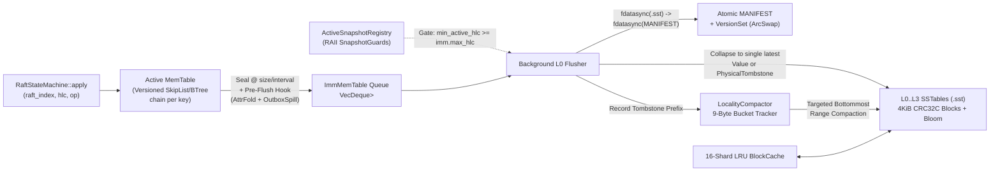

# EGM Subsystem Specification 1: Pure-Rust WAL-less LSM, `SnapshotGuard` MVCC & Locality-Aware Compaction (`metadb-storage`)

* **Status**: Phase 0 design note. Not a first-launch acceptance of the running tree.
* **Target Crate**: `crates/metadb-storage` (depends solely on `metadb-core` + pure-Rust utilities; zero C/C++ FFI)
* **Primary Reference**: Zebin Ren ([@ZebinRen](https://github.com/ZebinRen)), Biao Cao, Kang Chen ([@kangchenPKU](https://github.com/kangchenPKU)), Zhihui Yin, Qiushi Chen, Jielong Jian, Jiwei Xiong, Xinxing Wang, Yan Xing, Liguo Duan, Ran Zheng, Xianjun Meng, and Zhenyu Hou, *"MetaDB: Putting File-System Structure Back into Distributed Databases"*, [arXiv:2610.32247v1](https://arxiv.org/html/2610.32247v1) (Vrije Universiteit Amsterdam, Baidu & Peking University, 2026), §3.2 & §6
* **Semantic Boundaries**:
  * `FeatureRange`: Sections 1 – 5
  * `DetailedRange` (Zero-Decision Implementation Contract): Sections 6 – 10

---

## 1. Problem Statement (`FeatureRange`)

Metadata transactions in file systems and object stores are overwhelmingly short-lived (`<10ms` typical, hard-bounded at `5,000ms`), yet general-purpose LSM+MVCC storage engines (e.g., RocksDB-backed TiKV) persist every historical MVCC version and logical MVCC tombstone to SSTables alongside physical LSM deletion tombstones. Under consecutive bulk deletions (such as TTL object expiration on time-prefixed keys), passive level-saturation compaction leaves millions of dead tombstones across `L0–Ln`, causing foreground `listdir` scans (1,000 entries) to degrade from `<100ms` to `~6 seconds` while amplifying disk writes.

At the same time, omitting version metadata inside SSTables introduces two lethal hazards if designed naively:
1. **Future-Read Anomaly**: If an in-memory key updated at $T_2$ flushes to an unversioned SSTable while an active reader with snapshot $T_1 < T_2$ is still executing, that reader falling through memory to disk would illegally observe $T_2$'s overwritten value or tombstone.
2. **Shadowed-Key Resurrection**: If localized range compaction drops a physical LSM tombstone in an upper level (`L0`/`L1`) while an older live value for the same key still resides in a deeper level (`L2`/`L3`), the deleted file resurrects.

`metadb-storage` eliminates both hazards in a 100% pure-Rust WAL-less LSM engine.

---

## 2. Goals & Non-Goals (`FeatureRange`)

### Goals
* **G1 (Pluggable Pure-Rust WAL-less LSM)**: Provide a trait-abstracted `StorageBackend` backed by a disk-persistent sorted SSTable engine (`LsmStorageBackend`) with zero local KV WAL files (relying on `metadb-raft` for pre-flush durability).
* **G2 (Unversioned SSTable flush)**: `ActiveSnapshotRegistry` holds an `ImmMemTable` until `min_active_snapshot_hlc >= imm.max_hlc`, then writes a collapsed unversioned value or one physical tombstone. That is not a guarantee of zero future-read or phantom anomalies. Collapse may keep only the latest value. A range read at `start_hlc` can include later values of keys an open 2PC lease does not cover. Point reads of keys that lease records stay at the pre-image until commit. The `~60%` KV write reduction is a paper/model figure from `arXiv:2610.32247v1`, not a ratio asserted by `mvcc_snapshot_tests.rs`.
* **G3 (Coordinated Flush Barrier)**: Allow upper-layer `AsyncAttrAggregator` (`_attr_` folded deltas) and `AuxOutbox` (`[0x07]` overflow spills) to inject deterministic key-value entries atomically into the sealing `ImmMemTable` flush batch before `lsm_flushed_index` advances.
* **G4 (Bottommost-Safe Locality-Aware Compaction)**: Track physical tombstone density per 9-byte spatial prefix bucket (`[table_prefix][group_key: 8B]`) and compact dense buckets down to the deepest overlapping SSTable level so physical tombstones are legally purged in milliseconds.
* **G5 (Zero-Copy Checkpoint for Raft Snapshots)**: Materialize consistent point-in-time shard snapshots via hard-linked immutable `.sst` files and a standalone `MANIFEST`.

### Non-Goals
* **NG1**: Supporting snapshot reads older than `mvcc_retention_ms` (`5,000ms`).
* **NG2**: Standalone durability without an external write-ahead log (all mutations prior to `lsm_flushed_index` are replayed by `metadb-raft` on crash recovery).

---

## 3. High-Level Architecture (`FeatureRange`)



---

## 4. Alternatives Considered (`FeatureRange`)

1. **Embedding `rocksdb` Crate (`librocksdb-sys`)**: Rejected due to C++ FFI requirement, opaque compaction internals lacking 9-byte prefix tombstone-ratio triggers, and inability to natively gate MemTable collapse on `SnapshotGuard` HLC watermarks.
2. **Storing Full `(key, !hlc)` MVCC Keys in SSTables**: Rejected because persisting short-lived MVCC versions and logical tombstones creates the double-tombstone scan penalty documented in `arXiv:2610.32247v1` (§2.3.3 & §6.1) and increases persistent write volume by `~2.5x`.
3. **Wall-Clock-Only `5s` Delay Without `SnapshotGuard` Tracking**: Rejected because a reader stalled at `4.99s` could race with a `5.00s` flush mid-read unless active snapshots explicitly pin `min_active_snapshot_hlc` and check expiration atomically per read call.

---

## 5. Risks & Mitigations (`FeatureRange`)

| Risk | Mitigation |
| :--- | :--- |
| **Point Lookup False-Negative Across Levels When Key Was Deleted** | Insert `PhysicalTombstone` keys into SSTable Bloom filters alongside live keys so `get(K)` never skips an `L0` tombstone and reads a stale `L1` value. |
| **Stalled Reader Pinning `ImmMemTable` Queue Beyond RAM Budget** | Any `SnapshotGuard` older than `mvcc_retention_ms` (`5,000ms`) is marked expired (`AtomicBool` / creation `Instant`) and evicted from `min_active_snapshot_hlc` calculation; subsequent reads using that guard return `Err(MetaDbError::TransactionTimeout)`. If `ImmMemTable` count hits `max_imm_memtables` (`4`) within `<5s`, writers yield via async backpressure notify until the oldest `ImmMemTable` flushes. |
| **Power Failure Mid-Flush or Mid-Compaction** | Write SSTables to `<id:020>.sst.tmp`, `fdatasync` file, rename to `<id:020>.sst`, `fsync` directory, append CRC32C-framed `VersionEdit` to `MANIFEST`, `fdatasync(MANIFEST)`, and **only then** advance `lsm_flushed_index`. |

---

## 6. Mathematical MVCC Visibility & Safe-Flush Contract (`DetailedRange`)

### 6.1 Definitions
* Every shard tracks `latest_committed_hlc: HlcTimestamp` (strictly monotonic `(hlc, raft_index)` enforced in `RaftStateMachine::apply`) and `disk_flushed_max_hlc: HlcTimestamp` ($H_{\text{disk}}$, persisted in `MANIFEST`).
* **Pinned Read Cut (`SnapshotGuard` & `ReadCut`)**:
  Every `SnapshotGuard` captures a total immutable **`ReadCut { max_raft_index: u64, max_hlc: HlcTimestamp }`** alongside `(Arc<Version>, Vec<Arc<ImmMemTable>>, Arc<ActiveMemTableHandle>)` atomically under the synchronized state-machine + `ActiveSnapshotRegistry` lock. Because every applied Raft entry enforces strict monotonicity `(entry.hlc, entry.raft_index) > (prev.hlc, prev.raft_index)`, an in-memory `MvccVersion` is visible to guard $g$ **if and only if `v.raft_index <= g.cut.max_raft_index`**—guaranteeing that concurrent `RaftStateMachine::apply` calls (`raft_index > g.cut.max_raft_index`) NEVER become visible mid-scan even if their HLC falls below an externally supplied timestamp!
* **Dual Snapshot Acquisition APIs**:
  1. `acquire_linearizable_snapshot(&self, min_read_index: u64) -> Result<SnapshotGuard>`: Invoked after `applied_raft_index >= min_read_index`; captures `ReadCut { max_raft_index: current_applied_index, max_hlc: current_applied_hlc }`.
  2. `acquire_fixed_snapshot(&self, barrier_hlc: HlcTimestamp) -> Result<SnapshotGuard>`: Invoked for cross-shard `DualModeFineGrained` `dirstat` **after** advancing the local shard's HLC clock (`clock.update_checked(barrier_hlc)`) and completing `ReadIndex` (proving zero future Raft entries on this shard can ever commit with `hlc <= barrier_hlc`). Resolves `cut.max_raft_index` as the highest applied `raft_index` with `entry.hlc <= barrier_hlc` and sets `cut.max_hlc = barrier_hlc`. Rejects immediately with `Err(MetaDbError::TransactionTimeout)` if `barrier_hlc < disk_flushed_max_hlc` or `current_applied_hlc.physical_ms().saturating_sub(barrier_hlc.physical_ms()) > mvcc_retention_ms`.
  Thus **every admitted `SnapshotGuard` satisfies $g.\text{cut.max\_hlc} \ge H_{\text{disk}}$ and $g.\text{cut.max\_raft\_index} \ge \text{flushed\_raft\_index}$ at creation**.
* **Bounded Per-Page Lease & Forced Expiration**: Each `SnapshotGuard` tracks `created_at: Instant`, `expired: AtomicBool`, and a lightweight `RwLock<bool>` step-lease. Point `get` and bounded scan steps (`next_page` of up to `256` keys / one `DataBlock`) acquire the step read-lock only for the duration of that bounded step (`<100µs`), never across caller think time. When `created_at.elapsed() > mvcc_retention_ms` (`5,000ms`), the background flusher acquires the step write-lock in microseconds, sets `expired = true`, and evicts the guard from `ActiveSnapshotRegistry` so forced expiration never blocks L0 flushes indefinitely.
* **Safe-Flush Gate Invariant**: Let `imm` be the oldest `ImmMemTable` in the FIFO flush queue (`imm.max_hlc`, `imm.max_raft_index`). `imm` may collapse-flush to an unversioned L0 SSTable **if and only if**:
  1. Either the batching window (`coalesce_delay_ms`, default `200ms` under low memory, `0ms` when `imm_count >= 2` or during Raft snapshot creation) has elapsed, AND
  2. For every non-expired `SnapshotGuard` $g$ in `ActiveSnapshotRegistry`:
     $$g.\text{read\_hlc} \ge imm.\text{max\_hlc}$$
     (comparing the full 64-bit `HlcTimestamp`).

### 6.2 Proof of Snapshot Isolation Without SSTable Version Tags
When `imm` flushes to L0 SSTable, $H_{\text{disk}}$ advances to $\max(H_{\text{disk}}, imm.\text{max\_hlc})$. For every non-expired `SnapshotGuard` $g$, $g.\text{read\_hlc} \ge H_{\text{disk}}$ holds both for pre-existing guards (by Gate Condition 2) and for newly created guards (by the Snapshot Creation Invariant). Consequently:
* Every mutation with $hlc > H_{\text{disk}}$ still resides in younger `ImmMemTable`s or the active `MemTable` with full `(hlc, MvccValue)` chains.
* During `get(K, &g)` or `scan([start, end), &g)`:
  1. Inspect `ActiveMemTable` then `ImmMemTable`s from newest to oldest for the latest version of `K` with $v.\text{hlc} \le g.\text{read\_hlc}$. If found, return `Some(v)` or `None` (if `MvccValue::Tombstone`) immediately without consulting older `ImmMemTable`s or SSTables.
  2. If no version with $v.\text{hlc} \le g.\text{read\_hlc}$ exists in memory, the flush-gate argument treats `K` as unchanged in $(H_{\text{disk}}, g.\text{read\_hlc}]$. That argument does not cover an open 2PC lease. Collapse may retain only the latest value of a prepared key, which is still the pre-image until commit, and it does not pin every older version of other keys. A range read at `start_hlc` can include later values of keys the lease does not cover.

### 6.3 Coordinated Flush Barrier API
When sealing `ActiveMemTable` at `max_raft_index = M`:
```rust
pub trait PreFlushHook: Send + Sync {
    /// Invoked atomically when sealing ActiveMemTable up to `sealed_raft_index = M`.
    /// CRITICAL: `view_at_m` spans `SealingMemTable (<= M) -> queued ImmMemTables (newest->oldest, <= M) -> VersionSet`
    /// (NOT `VersionSet` alone!), so baseline `_attr_` records created or folded in an earlier
    /// queued `ImmMemTable` (e.g., at `M_prev < M` not yet flushed to disk) are observed accurately,
    /// folding strictly deltas in `(baseline.applied_raft_index, M]`.
    fn on_seal_memtable(
        &self,
        sealed_raft_index: u64,
        sealed_max_hlc: HlcTimestamp,
        view_at_m: &ViewAtRaftIndex<'_>,
    ) -> Result<Vec<(Vec<u8>, HlcTimestamp, MvccValue)>>;

    /// Invoked strictly AFTER the resulting L0 SSTable and MANIFEST are fdatasync'd
    /// and the new `Version` is published in `VersionSet`.
    /// Returns the new contiguous `aux_outbox_durable_index` frontier (which reaches `M`
    /// only when all unresolved tasks `<= M` were spilled into `[0x07]`, never advancing
    /// unconditionally past unspilled/unacked tasks `<= M`).
    fn on_flush_durable(&self, durable_raft_index: u64, durable_max_hlc: HlcTimestamp) -> u64;
}
```
Because `on_flush_durable(M)` runs strictly after `VersionSet` publication and `MANIFEST` `fdatasync`:
* Readers before `VersionSet` swap read old `_attr_` (`applied_index = M_prev`) + in-memory deltas `(M_prev, latest]`.
* Readers after `VersionSet` swap read new `_attr_` (`applied_index = M`) + in-memory deltas `(M, latest]`.
* Only inside `on_flush_durable(M)` are in-memory deltas `<= M` pruned, `state_flushed_index` advanced to `M`, and `aux_outbox_durable_index` advanced strictly to the contiguous durable-coverage frontier returned by the outbox hook.

---

## 7. On-Disk Binary Formats (`DetailedRange`)

### 7.1 Directory Hierarchy per Shard
```text
<data_dir>/shards/<shard_id:020>/
└── lsm/
    ├── LOCK                       # flock exclusive process lock
    ├── CURRENT                    # UTF-8 filename of active MANIFEST + '\n'
    ├── MANIFEST-000001            # Append-only CRC32C-framed VersionEdit log
    ├── 00000000000000000001.sst   # Immutable SSTable file
    └── 00000000000000000002.sst
```

### 7.2 SSTable File Layout (`*.sst`)
All integer fields inside SSTable framing use **little-endian (`LE`)** encoding; user keys themselves remain **big-endian (`BE`)** as encoded by `metadb-core` so byte-wise `memcmp` preserves numeric `PID`/`UID`/`FID` order.

```text
+-------------------------------------------------------------------+
| Data Block 0  (target 4096 B, prefix-compressed, restart=16, CRC) |
| Data Block 1  ...                                                 |
| Data Block N-1                                                    |
+-------------------------------------------------------------------+
| Filter Block  (10 bits/key Kirsch-Mitzenmacher Bloom + CRC32C)    |
+-------------------------------------------------------------------+
| Index Block   (1 entry per Data Block: last_key, offset, len +CRC)|
+-------------------------------------------------------------------+
| Meta Block    (min_key, max_key, entries, tombstones, level,      |
|                max_raft_index, max_hlc + CRC32C)                  |
+-------------------------------------------------------------------+
| Fixed 64-Byte Footer                                              |
+-------------------------------------------------------------------+
```

* **Data Block Entry Wire Format**:
  * `shared_prefix_len: u16 LE` (`0` at indices `0, 16, 32, ...`)
  * `unshared_key_len: u16 LE`
  * `entry_tag: u8` (`0x01 = Value`, `0x02 = PhysicalTombstone`)
  * `value_len: u32 LE` (`0` when `entry_tag == 0x02`)
  * `unshared_key_bytes: [u8; unshared_key_len]`
  * `value_bytes: [u8; value_len]`
  * Block suffix: `[restart_offsets: u32 LE * R][num_restarts: u32 LE][block_crc32c: u32 LE]`
* **Filter Block Wire Format**:
  * Bitset of length `max(64, ceil(num_keys * 10 / 8))` bytes (`num_probes k = 7`).
  * **Crucial Rule**: Both `entry_tag == 0x01` (`Value`) and `entry_tag == 0x02` (`PhysicalTombstone`) keys MUST be inserted into the Bloom filter so point lookups never bypass a newer tombstone in `L0`.
  * Suffix: `[k_probes: u8 (=7)][filter_crc32c: u32 LE]`.
* **Index Block Wire Format**:
  * `[num_blocks: u32 LE]`, followed by `num_blocks` records: `[last_key_len: u32 LE][last_key_bytes][block_offset: u64 LE][block_len: u32 LE]`, followed by `[index_crc32c: u32 LE]`.
* **Meta Block Wire Format**:
  * `[min_key_len: u32 LE][min_key_bytes][max_key_len: u32 LE][max_key_bytes][num_entries: u64 LE][num_tombstones: u64 LE][level: u8][flush_generation: u64 LE][max_raft_index: u64 LE][max_hlc: u64 LE][meta_crc32c: u32 LE]`.
* **Fixed 64-Byte Footer Wire Format** (byte offsets `[file_len - 64 .. file_len)`):
  * `[0..8]`: `filter_offset: u64 LE`
  * `[8..16]`: `filter_len: u64 LE`
  * `[16..24]`: `index_offset: u64 LE`
  * `[24..32]`: `index_len: u64 LE`
  * `[32..40]`: `meta_offset: u64 LE`
  * `[40..48]`: `meta_len: u64 LE`
  * `[48..52]`: `format_version: u32 LE` (`1`)
  * `[52..56]`: `footer_crc32c: u32 LE` (computed over bytes `[0..52]` + `[56..64]`)
  * `[56..64]`: `magic: u64 LE` (`0x4D455441_53535431`, ASCII `"METASST1"`)

### 7.3 `MANIFEST` Binary Grammar, Rotation & Strict Recovery Policy
Each `VersionEdit` record in `MANIFEST-<seq:06>`:
* `[0..4]`: `payload_len: u32 LE`
* `[4..8]`: `payload_crc32c: u32 LE`
* `[8..8+payload_len]`: deterministic binary `VersionEdit` (`edit_format_version: u8 = 1`):
  * `has_next_file_id: u8`, `next_file_id: u64 LE`
  * `has_next_flush_gen: u8`, `next_flush_generation: u64 LE`
  * `has_durable_checkpoint: u8`, `DurableShardCheckpoint` (`flushed_raft_term: u64 LE`, `flushed_raft_leader: u64 LE`, `flushed_raft_index: u64 LE`, `flushed_max_hlc: u64 LE`, `contiguous_aux_acked_index: u64 LE`, `membership_len: u32 LE`, `membership_bytes`, `descriptor_len: u32 LE`, `descriptor_bytes`)
  * `deleted_count: u32 LE`, `[(level: u8, file_id: u64 LE); deleted_count]`
  * `added_count: u32 LE`, `[SstFileMeta; added_count]` where each `SstFileMeta` is framed as:
    `[level: u8][file_id: u64 LE][flush_generation: u64 LE][file_size: u64 LE][min_key_len: u32 LE][min_key_bytes][max_key_len: u32 LE][max_key_bytes][num_entries: u64 LE][num_tombstones: u64 LE][max_raft_index: u64 LE][max_hlc: u64 LE]`.
* **`MANIFEST` Recovery Policy**:
  * Replay records sequentially from `CURRENT`. **Only an incomplete/torn final record at EOF** (truncated tail from a crash mid-append) may be truncated back to the last complete record boundary; **any CRC32C failure or malformed grammar in a non-final record MUST fail startup immediately with `MetaDbError::ManifestCorrupted`**.
  * Rotation: Write full baseline `VersionEdit` to `MANIFEST-<new_seq:06>`, `fdatasync` it, write `"MANIFEST-<new_seq:06>\n"` to `CURRENT.tmp`, `fdatasync(CURRENT.tmp)`, `rename("CURRENT.tmp", "CURRENT")`, `fsync(lsm_dir)`, and unlink superseded `MANIFEST-*`.
* **Deterministic Merge Precedence (`MergingIterator`)**:
  For identical user keys, `MergingIterator` resolves winner precedence strictly as:
  `ActiveMemTable (highest raft_index <= cut.max_raft_index)` > `ImmMemTables (descending max_raft_index)` > `L0 SSTables (descending flush_generation)` > `L1` > `L2` > `L3`.

---

## 8. Compaction Strategy & Bottommost Tombstone Rule (`DetailedRange`)

### 8.1 Level Topology (`L0` – `L3`)
* `L0`: Overlapping key ranges flushed directly from `ImmMemTable` (ordered newest-first by `flush_generation`). Standard tiered-to-leveled compaction triggers when `l0_file_count >= 4`, merging all overlapping `L0` and `L1` SSTables into non-overlapping `64 MiB` `L1` SSTables.
* `L1` (`512 MiB` target), `L2` (`4 GiB` target), `L3` (`32 GiB+` target): Non-overlapping sorted runs per level.

### 8.2 `LocalityCompactor` Trigger & Execution
* Spatial bucket key: `RangeBucketPrefix = [u8; 9]` (`[table_prefix: 1B][group_key: 8B BE]`).
* Per bucket in-memory counters: `(tombstone_writes: u32, live_writes: u32)`.
* Trigger condition on L0 flush:
  `tombstone_writes >= density_threshold` (default `128`) **AND** `tombstone_writes * 2 >= tombstone_writes + live_writes` (`>= 50%` tombstone ratio).
* Execution of `compact_range(start_key, end_key)`:
  1. Acquire compaction scheduling lock (allowing concurrent foreground reads via pinned `Arc<Version>` in `SnapshotGuard` and concurrent MemTable writes/flushes; skipping files already participating in an active compaction).
  2. Collect **all** SSTables across `L0..L3` whose `[min_key, max_key]` overlaps `[start_key, end_key)`. Notice that `L0` SSTables may have wide key spans (`[min_U, max_U]` straddling well outside `[start_key, end_key)`): if `L0` files are included, also include any `L1` SSTables overlapping the union span `[min_U, max_U]` so `target_level` (`max(1, deepest_overlapping_level)`) has strictly non-overlapping runs!
  3. **Full Rewrite of Participating Input SSTables**: Every key across `[min_U, max_U]` from **all** participating input SSTables MUST be merged and rewritten into valid non-overlapping output SSTables at `target_level` before any input `.sst` is marked deleted in `VersionEdit` (no partial-file slicing that could drop outer keys).
  4. **Bottommost Tombstone Drop Invariant**: For any merged key `K` whose winning entry is `PhysicalTombstone`, `K` is **omitted** from the output SSTable **if and only if** zero non-participating SSTables in levels `> target_level` satisfy `sst.min_key <= K <= sst.max_key` (which is guaranteed for all `K ∈ [start_key, end_key)` because step 2 gathered every overlapping SSTable down to `L3`; for outer boundary keys `K ∉ [start_key, end_key)` carried by wide input SSTables, `Version::has_overlap_above(target_level, K)` is checked per key, retaining `PhysicalTombstone` whenever a deeper non-participating SSTable overlaps `K`!).
  5. Commit atomic `VersionEdit` (`added_files` + `deleted_files`) to `MANIFEST`, swap `VersionSet`, and unlink old `.sst` files once `Arc<SstableReader>` refcounts reach zero.

---

## 9. Target File Boundaries & Public Rust Traits (`DetailedRange`)

* `crates/metadb-storage/Cargo.toml`
* `crates/metadb-storage/src/lib.rs`
* `crates/metadb-storage/src/backend.rs` — `StorageBackend` trait (`LsmStorageBackend` + lightweight `InMemoryBackend` for unit tests)
* `crates/metadb-storage/src/block.rs` — `DataBlockBuilder`, `DataBlockIterator`
* `crates/metadb-storage/src/bloom.rs` — `BloomFilterBuilder`, `BloomFilter`
* `crates/metadb-storage/src/cache.rs` — `ShardedBlockCache` (16 LRU shards)
* `crates/metadb-storage/src/sstable.rs` — `SstableBuilder`, `SstableReader`, `SstableIterator`
* `crates/metadb-storage/src/manifest.rs` — `ManifestLog`, `VersionEdit`, crash recovery & rotation
* `crates/metadb-storage/src/version_set.rs` — `Version`, `VersionSet`, `MergingIterator`
* `crates/metadb-storage/src/mvcc.rs` — `MemMvccStore`, `ImmMemTable`, `ActiveSnapshotRegistry`, `SnapshotGuard`
* `crates/metadb-storage/src/compaction.rs` — `LocalityCompactor`, `LeveledCompactor`
* `crates/metadb-storage/src/engine.rs` — `LifecycleStorageEngine` orchestrating MVCC + `PreFlushHook` + `StorageBackend`

---

## 10. Verification & Fault-Injection Test Plan (`DetailedRange`)

1. **T-LSM-1 (SSTable & Bloom Tombstone Shadowing Test)**: Write `K -> V1` to `L1`, flush `K -> PhysicalTombstone` to `L0`, verify `get(K)` hits `L0` Bloom filter and returns `None` (never resurrecting `V1`), and verify corrupted byte flips in Data/Filter/Index/Footer fail with `MetaDbError::ChecksumMismatch`.
2. **T-LSM-2 (`MANIFEST` Torn-Write & `.sst.tmp` Recovery Test)**: Inject partial/corrupted trailing bytes into `MANIFEST-000001` and leave orphan `.sst.tmp` files on disk; reopen `LsmStorageBackend` and verify exact recovery to `flushed_raft_index` and automatic `.sst.tmp` cleanup.
3. **T-MVCC-1 (`SnapshotGuard` Future-Read Prevention Test)**: Acquire `SnapshotGuard` $g_1$ at $T_1$, overwrite `K -> V2` and delete `K2` at $T_2 > T_1$, seal `ActiveMemTable`, verify `L0` flush stays gated while $g_1$ is live, verify $g_1$ still reads `V1` and `K2`, drop $g_1$, verify `L0` collapse-flushes single unversioned entries, and verify expired guard (`>5s`) returns `MetaDbError::TransactionTimeout`.
4. **T-COMP-1 (Bottommost-Safe `LocalityCompactor` Test)**: Populate `L2` with live keys across `PID=10` and `PID=11`, flush 200 deletions for `PID=10` to `L0`, verify `LocalityCompactor` compacts `[PID=10, PID=11)` across `L0..L2`, purges 100% of `PID=10` tombstones (`tombstones_traversed_on_scans == 0`), does not rewrite non-overlapping `PID=99` SSTables, and never resurrects deleted `L2` values.
